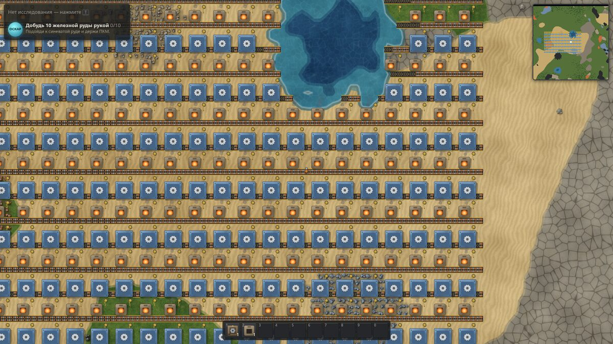
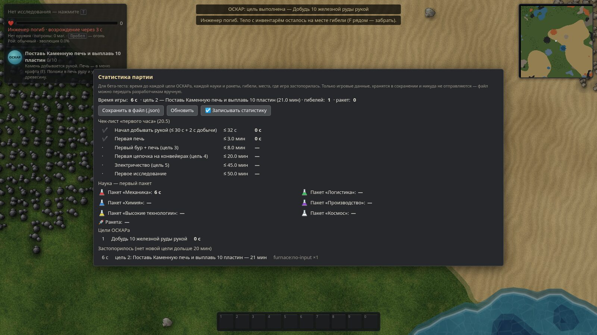
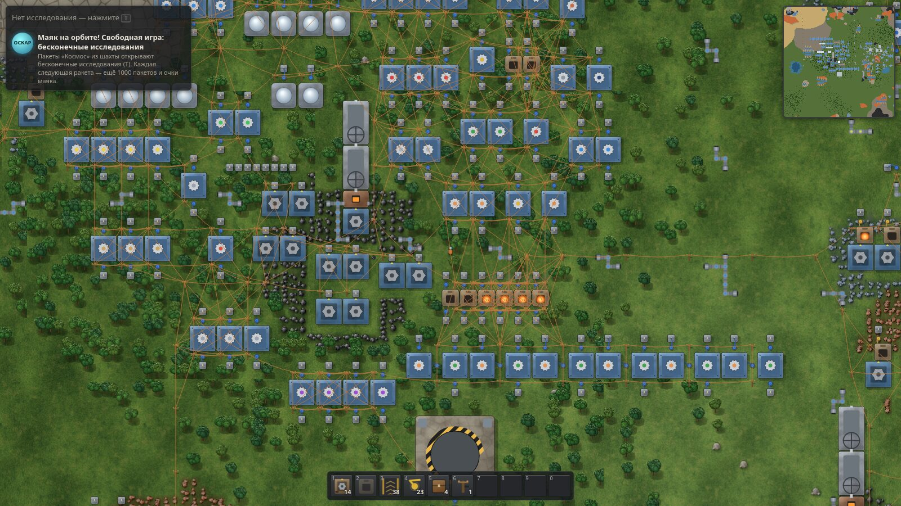
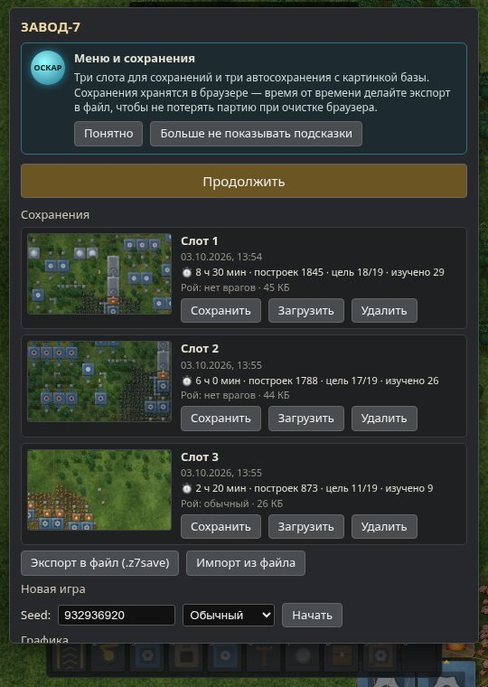
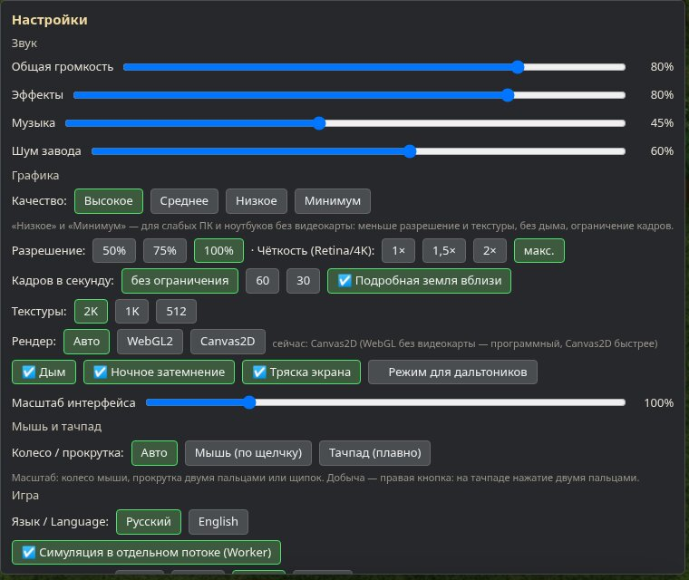

# ЗАВОД-7 — 1.17.0-dev.1

Проверяемая версия полного обновления 1.17; выпуск ещё не принят. Формат сохранения — **21**. Перед открытием старого мира сохраните его копию: обратная загрузка нового содержимого в 1.16 или alpha.5 не поддерживается.

Текущие проверки и ограничения: [CHECKS-1.17-dev.md](CHECKS-1.17-dev.md), [дополнительная приёмка 20 октября](docs/RELEASE-ACCEPTANCE-20261020.md). После ранее выданных архивов исправлены native server/relay/WebSocket. Приняты отдельные Edge E2E34–38, короткие direct/TLS-relay прогоны 16 сетевых клиентов, приглашения/перезапуск шлюза/отзыв, browser landing, WebRTC, сценарий и скриптовый мод в поставляемом отдельном процессе. Предыдущий точный `npm test` завершился0 (RU/EN — 6279 строк); повторный полный прогон на новых исходниках ещё идёт, результат не переносится автоматически с прежнего архива.

**Запуск игры:** открыть `dist/index.html` в Chrome/Edge; в игровом архиве — `index.html`. Windows-компонент отдельного сервера находится в `dist/native/`; собственный Node включён в поставку. Установщик собран, но установка/регистрация на чистой системе ещё не проверены. Публичная служба приглашений не развёрнута. Для бесплатного стенда подготовлены `render.yaml` и [инструкция Render](docs/PUBLIC-RELAY-PROPOSAL-20261020.md); пользователь подключает аккаунт/репозиторий самостоятельно. Firefox и WebKit/Safari отложены в отдельный патч.

**Сборка исходников:** `npm ci`, затем `npm run build`. Для Windows-сервера нужны Node 22.23.2 и .NET Framework C# compiler: `npm run native:build`. Обычная браузерная сборка не требует Windows-компонента. Подробности сервера: [документ реализации](docs/NATIVE-SERVER-IMPLEMENTATION-1.17.md).

## История alpha.5

Пятая альфа продолжает биоматериалы: четыре направления летуна — подкладки скорости +3%, расхода энергии оборудования −4% и лазерной защиты −4%, а также дробь с разбросом −4%. Производство проходит через видовую пробу, биогель, фракцию и композит. Перенесены исправления из 1.16: пересечения подземных труб, красные/зелёные провода длиной до 30 клеток и ручная/автоматическая заправка локомотива. План: [alpha.5](docs/PLAN-1.17-alpha5.md); доказательства и ограничения: [проверки](docs/CHECKS-1.17-alpha5.md). Полная 1.17 ещё разрабатывается.

Четвёртая альфа добавляет станцию биосбора и санитарных роботов: автоматический забор видовых проб, сбор слизи и очистку тонкой плёнки. Станция 3×3 обслуживает до четырёх роботов в радиусе 24 клеток и потребляет до 120 кВт. Новому роботу нужна зарядка: 50 секунд на месте мощностью 30 кВт. Настройки, заряд, груз и задания сохраняются и передаются участникам кооператива. Объём этапа: [план](docs/PLAN-1.17-alpha4.md), фактическая приёмка: [проверки](docs/CHECKS-1.17-alpha4.md).

Формат сохранения — 20, как в alpha.4. Мир из альфы 3 загружается с миграцией. Для возврата к alpha.4, альфе 3 или 1.16 нужна исходная копия мира до появления нового содержимого. Полная 1.17 ещё разрабатывается.

Третья альфа: направления I–IV ползунов и панцирника, минеральное покрытие, точная дробь и подкладки скорости, физической, огненной и взрывной защиты. Минеральные направления панцирника расходуют настоящую серную кислоту. Одновременно действует одна биоподкладка. Это часть 1.17. План: docs/PLAN-1.17-alpha3.md; результаты: docs/CHECKS-1.17-alpha3.md.

Все требования полного обновления кратко: [сводка 1.17](docs/ROADMAP-1.17-SHORT.md). Сводка описывает ТЗ, а не готовность функций.

Первая альфа биоматериалов: временные останки, биосборник, капсулы и очистка слизи в биогель. Объём того этапа — [план](docs/PLAN-1.17-alpha1.md), проверки — [отчёт](docs/CHECKS-1.17-alpha1.md), актуальное продолжение — [CONTINUE-1.17.md](CONTINUE-1.17.md).

**v1.1 «Стабилизация» (rc.1 — готово к сбору данных):** Esc → «Помочь игре», окно «Что нового», замер производительности `?bench=1`, статистика v2 и сводка `tools/stats-report.ts`. Как собрать данные и закрыть критерии — [`docs/V1.1-PLAYTEST.md`](docs/V1.1-PLAYTEST.md).

Релиз 1.0: все этапы роадмапа M0–M10 и план 1.0 (рендер WebGL2, бета-тест, баланс, совместимость, озвучка, подсказки, слоты с превью) закрыты, финальная проверка по разделу 19 — в [`docs/RELEASE-1.0.md`](docs/RELEASE-1.0.md), история версий — в [`CHANGELOG.md`](CHANGELOG.md).

Браузерная 2D-игра про строительство завода (factory-builder) по дизайн-документу v1.0.
Реализованы этапы **M0–M9** роадмапа: от ручной добычи до запуска ракеты. В v0.3 добавлены удобства (M8: чертежи, снос/улучшение, отмена, статистика за часы) и поздняя игра (M9: модули, маяки, Сборщик 3, электропечь, аккумуляторы, ракетная шахта, финал и бесконечные исследования).

Версия 1.0-rc1 завершает M10: симуляция работает в отдельном потоке (Web Worker), интерфейс переведён на английский, есть режим для дальтоников и масштаб интерфейса до 200%.

**Играть:** откройте `dist/index.html` в Chrome/Edge 80+, Firefox 113+ или Safari 16.4+. Сервер и интернет не нужны.
**Как приложение (PWA):** выложите папку `dist/` на любой статический хостинг (или `npx serve dist`), откройте по https и нажмите «Установить» в адресной строке — игра будет работать офлайн.

## Что реализовано (по разделам документа)
| Раздел | Статус |
|---|---|
| 4. Мир | Бесконечная сетка, чанки 32×32, детерминированная генерация по seed (simplex + fbm): трава, песок, камень, вода. Руды: железо, медь, уголь, камень. Деревья и скалы. Стартовая зона: гарантированные поля и озеро рядом, богатство растёт с расстоянием. Туман войны (чанки открываются в радиусе 3). |
| 5. Персонаж | WASD, 8,9 клетки/с, столкновения, дальность 10 / 2,7, добыча рукой 0,5 ед/с, инвентарь 80 ячеек со стопками, езда на конвейере. |
| 6. Рецепты | Плавка, промежуточные детали, красная и зелёная наука, все постройки. Ручной крафт с очередью, промежуточные детали делаются сами. |
| 7. Постройки | Конвейер (жёлтый и красный), подземный конвейер, разделитель, 4 типа манипуляторов, 2 сундука, 2 бура, 2 печи, сборщики 1 и 2, лаборатория, береговой насос, труба, бойлер, паровой двигатель, малый столб, солнечная панель. |
| 8.1 Конвейеры | 2 дорожки, 4 предмета на клетку, целочисленные позиции (1/256 клетки), автоповороты, боковая подача на ближнюю дорожку, подземные, разделитель 1:1. |
| 8.2 Манипуляторы | Машина состояний, «что брать и куда класть», кладут на дальнюю дорожку, лимиты для сборщиков, твердотопливный сам себя заправляет. |
| 8.4 Сборщики | Лимит на входе по формуле документа, значки состояния. |
| 8.5 Электричество | Union-find по столбам, зоны покрытия, спрос и предложение, дежурный режим 1/30, удовлетворение сети замедляет машины, окно сети с графиком. |
| 8.6 Жидкости | Модель «одна сеть — один бак», запрет смешения жидкостей. Вода → бойлер → пар → двигатель. |
| 9. Исследования | 9 технологий эпох 1–2, окно технологий (T), цели ОСКАРа (10 шагов, по п. 9.4). |
| 11. Интерфейс | HUD, мини-карта, карта (M), хотбар 1–0, очередь крафта, подсказки, окна построек, статистика производства (P), Alt-режим, призрак постройки с причиной отказа, протягивание. |
| 13. Баланс | Числа из документа: скорости, мощности, топливо, время рецептов. День и ночь — 7 минут. |
| 14. Архитектура | Симуляция без DOM (готова к переносу в Worker), команды `{t, ...}` применяются в начале тика, фиксированный шаг 60 UPS, свой ГПСЧ xoshiro128**, детерминизм проверяется тестом. |
| 16. Сохранения | 3 слота и автосохранение каждые 5 минут (3 слота по кругу) в localStorage, сжатие deflate, экспорт и импорт файла `.z7save`. Сохраняются только изменения чанков, сети пересобираются. |
| 6.4–6.5 Нефть и химия (M5) | Нефтяные источники (гарантированное поле у старта + случайные), насос-качалка, НПЗ (простая/глубокая переработка), химзавод (пластик, сера, кислота, крекинг, твёрдое топливо), цистерна, подземная труба (10 клеток). Фильтры жидкостных входов/выходов задаются рецептом. Двигатель, продвинутая схема, синяя наука, 12 новых технологий. |
| 10.1 Загрязнение | Выбросы по постройкам, диффузия между чанками (2% каждые 64 тика), поглощение почвой и деревьями, слой на карте и в мире (U). |
| 10.2 Рой | Гнёзда дальше 260 клеток от старта, рост от поглощённого загрязнения, группы атак по A* к источникам загрязнения, 5 типов (малый/средний/большой ползун, плевун, гигант) с сопротивлениями, эволюция (время + загрязнение + уничтожение гнёзд), захват земли, защита гнёзд. |
| 10.3 Оборона и бой | Пулемётная турель (поворот, трассеры, вспышки), стены, пистолет и пистолет-пулемёт (Пробел), 2 типа магазинов, ремонтные наборы, прочность построек, смерть и возрождение с телом-инвентарём. |
| 10.4 Режимы | Нет врагов / Мирный / Обычный / Мир смерти; мирный ↔ обычный переключается в статистике (P). |
| 15. Графика 2K | Процедурные бесшовные текстуры **2048×2048** (трава, песок, камень, грунт, мелкая и глубокая вода, каустики, металл, грязь, макро-вариация) генерируются при запуске в параллельных Web Worker'ах, с mip-цепочкой. Контуры почв — «марширующие квадраты» по сглаженному полю, пена и мокрый песок у берега, анимированная вода. Спрайты 256 px/клетку: руда (4 уровня богатства), деревья (сортировка по глубине), скалы, нефть. Материалы построек — оверлей 2K-металла/камня. Качество 2K / 1K / 512 — в меню (Esc). |
| 16. Сохранения v2 | Миграция v1 → v2 (старые сохранения открываются в мирном режиме). |
| 12. Чертежи (M8) | Ctrl+C / Ctrl+X — рамка → чертёж (постройки, направления, рецепты; призраки тоже). Чертёж в руке: R — поворот, F / G — отражение, ЛКМ — вставка, протягивание — вставка рядами. Библиотека (B) в localStorage: переименование, удаление, строка чертежа `0` + base64(deflate(JSON)) для обмена, импорт, список недостающих предметов. Ctrl+V — последний чертёж. |
| 12. Призраки и планировщики (M8) | Чего нет в инвентаре — ставится призраком и строится само, когда инженер рядом и предмет появился. Снос (Alt+D) с фильтрами «всё / конвейеры / кроме конвейеров» и деревьями; улучшение (Alt+U) по таблице пар; ПКМ-рамка снимает пометки. Быстрая замена (ставить красный конвейер поверх жёлтого и т. п.) сохраняет содержимое, рецепт и модули. Отмена / повтор (Ctrl+Z / Ctrl+Y, 50 шагов). |
| 11. Интерфейс (M8) | Статистика за 1 мин / 10 мин / 1 ч / 10 ч, график по предмету (щелчок по строке). Технологии сгруппированы по эпохам. Alt-режим показывает модули и части ракеты, не срабатывает в сочетаниях (Alt+D). Окна для сети: пар / солнце / аккумуляторы и общий запас. Мини-карта показывает призраки. |
| 8.7 Модули и маяки (M9) | 9 модулей (скорость, продуктивность, эффективность 1–3) с числами из документа. Слоты у сборщиков 2/3, электропечи, электробура, лаборатории, качалки, НПЗ, химзавода, шахты. Маяк: 50% эффекта своих модулей на всё в радиусе 3 клеток, продуктивность не принимает. Продуктивность — только для промежуточных продуктов, шкала бонуса в окне. |
| 7. Постройки (M9) | Экспресс-конвейер, стальной сундук, средний и большой столбы, подстанция, Сборщик 3 (вход жидкости), электропечь, маяк, аккумулятор (5 МДж / 300 кВт: заряд от излишков, разряд ночью), радар (видит 7×7 чанков, разведывает по спирали), ракетная шахта 9×9. |
| 9. Исследования (M9) | 43 технологии в 5 эпохах + 3 бесконечные (продуктивность добычи, урон оружия, скорость лабораторий: стоимость ×1,5 за уровень). Новые пакеты «Производство», «Утилиты», «Космос». |
| 1. Финал (M9) | Ракетная шахта: 100 частей ракеты (лёгкий каркас + ракетное топливо + процессор) и спутник-маяк → запуск с анимацией, окно победы со статистикой, +1000 пакетов «Космос», свободная игра. Цели ОСКАРа доведены до конца игры. |
| 16. Сохранения v3 | Призраки, пометки, ракеты, уровни бесконечных технологий, модули. Миграция v2 → v3. |
| M10. Звук | Всё синтезируется WebAudio на лету (ни одного файла): 18 эффектов (стройка, разбор, кирка, топор, крафт, исследование, цель, тревога, ошибка, взрыв, ползуны, кислота, турель, выстрел, гибель, старт ракеты), позиционирование по расстоянию и панораме, ограничение частоты. Фон завода: гул машин, дребезг конвейеров, пар — по тому, что работает рядом. Генеративная эмбиент-музыка (ля минор, пьесы ~3 мин и паузы). |
| M10. Настройки | Окно настроек (Esc → Настройки): громкость общая / эффекты / музыка / шум завода, текстуры, дым, ночное затемнение, тряска экрана, масштаб интерфейса 75–200%, автосохранение (выкл / 2 / 5 / 10 мин), **переназначение 16 клавиш**; подсказки в HUD и окне «Управление» показывают текущие клавиши. |
| M10. Сохранения в IndexedDB | Слоты и автосохранения — в IndexedDB (сотни МБ вместо ~5 МБ), старые сохранения из localStorage переносятся автоматически. `navigator.storage.persist()` при ручном сохранении; в меню видно, постоянное ли хранилище и сколько занято. |
| M10. Фоновая работа | Во фоновой вкладке браузер не рисует кадры и режет таймеры — симуляцию будит таймер в Web Worker (20 раз/с), завод продолжает работать, автосохранение идёт. |
| M10. Графика | Дым из печей, бойлеров и буров на топливе, клубы при старте ракеты, тряска экрана от взрывов. Иконка игры. |
| M10. PWA | Манифест, иконки 192/512/SVG, service worker с офлайн-кешем (`dist/sw.js` создаётся при сборке). С `file://` игра работает как раньше. |
| M10. Симуляция в Worker (14) | Вся логика игры работает в Web Worker с фиксированным шагом 60 UPS. Главный поток только рисует и показывает интерфейс: держит «зеркало» состояния и получает снимки — постройки в видимой области и в открытом окне, изменённые чанки, сети, статистику. Ввод и команды отправляются сообщениями, сохранение упаковывается прямо в Worker. Если Worker недоступен, или в адресе есть `?local`, или в настройках выключено «Симуляция в отдельном потоке», игра работает в главном потоке как раньше. В отладке (F3) видно «Worker, UPS 60». |
| 11.5. Локализация | Русский и английский. Язык выбирается в настройках и меняется сразу, без перезагрузки; по умолчанию — по языку браузера. Перевод сделан словарём фраз (`src/core/i18n.ts`, ~650 строк) и применяется при выводе: окна, HUD, подсказки, сообщения, надписи на холсте. Поэтому симуляция не зависит от языка. Тест проходит по всем окнам, постройкам и подсказкам и проверяет, что не осталось кириллицы. |
| 11.5. Доступность | Режим для дальтоников: палитра Okabe–Ito для пакетов науки и значок формы на каждой колбе (круг, треугольник, квадрат, ромб, звезда, кольцо), контрастные провода. Масштаб интерфейса 75–200%. Озвучка ОСКАРа и интерфейса синтезом речи (rc6). |
| 19. Тесты | Юнит-тесты логики, тест детерминизма, бенчмарк, E2E на Playwright (`e2e7` — режим Worker, `e2e8` — EN, дальтоники, масштаб, `e2e9` — рендеры, `e2e10` — снимки Worker, `e2e11` — инструменты бета-теста, `e2e12` — совместимость в Chromium/Firefox/WebKit, `e2e13` — озвучка, подсказки, слоты), архив старых сохранений (`compat.test`), бот-тест прохождения до ракеты (`npm run bot`).. 1.0: `core19` (пропускная способность конвейеров, манипуляторы, сети, рецепты, исследования), хаос-тест, бенчмарки трёх сцен с базой, `e2e14` (средняя база), CI GitHub Actions. 1.1: `stats.test` (сводка плейтестов, миграция v3 → v4), `e2e15` (окна v1.1 и замер в трёх браузерах). |

## Известные ограничения 1.0
- **Время до ракеты — оценка, а не замер на людях.** «≈ 24 ч» получено пересчётом прохождения бота (seed 1, без врагов, ракета за 8 ч 14 мин) по темпу плана 9.3. Живых плейтестов не было: статистика партии (rc3) и чек-лист 20.5 готовы, их нужно собрать у игроков.
- **Safari и тачпады:** проверены движком WebKit 18.2 под Linux и синтетическими событиями, не настоящим Safari на macOS.
- **Озвучка** проверена подменой `speechSynthesis` (в headless-браузерах голосов нет) — как звучат голоса Windows/macOS/Android, нужно послушать вживую.
- **FPS без видеокарты:** все замеры — программный рендер в headless Chromium. Время кадра в главном потоке на средней базе (1 788 построек) — 3–5 мс в WebGL2, симуляция — 60 UPS; реальные кадры/с на GPU покажет панель F3 у игроков.
- **Архив старых сохранений** восстановлен по истории формата (rc5), а не собран у игроков. История отмены в сохранение не входит (как в Factorio).
- Бот проходит игру на одной карте и без Роя; партии с Роем проверены хаос-тестом (10 мин случайных действий), а не прохождением.

## v1.1 — стабилизация
Цель — проверить на живых игроках и настоящих GPU то, что в 1.0 мерилось ботом и без видеокарты.
- **Игроку:** Esc → «Помочь игре» → «Сохранить статистику» (`zavod7-playtest-*.json`), «Замер производительности» (новая вкладка `?bench=1`, ~25 с, `zavod7-gpubench-*.json`), «Отчёт об ошибке (F8)».
- **Сводка:** `npx tsx tools/stats-report.ts playtests/ --out report.md` — таблица критериев, время до целей и этапов, застревания, ошибки, замеры, предложение правки баланса. Пример на синтетике — `docs/stats-report-SYNTHETIC.md`.
- **Сборка с формой обратной связи:** `ZAVOD_FEEDBACK=https://… npm run build`.
- **Статус:** критерии «Готово, когда» ждут данных — нужно ≥ 10 игроков, дошедших до ракеты, и замеры на 6 конфигурациях (`docs/V1.1-PLAYTEST.md`).

## v1.2 — строительные роботы
- **Робопорт** (синяя наука, «Строительные роботы»): зона стройки 110×110 (оранжевая), логистики 50×50 (жёлтая), 4 места зарядки, буфер 100 МДж. Порты с пересекающимися жёлтыми зонами — одна сеть.
- **Роботы** строят призраки и чертежи, сносят, улучшают, чинят (ремнаборы из порта) и восстанавливают разрушенное Роем; предметы берут из сундуков в жёлтой зоне и из инвентаря инженера в зоне. Зоны — по Alt, при наведении на робопорт или призрак и при открытом окне порта.
- **Окно робопорта:** свободные / в работе / заряжаются, очередь задач по типам, нехватка предметов, «Загрузить из инвентаря», «Забрать всё». Значки на призраках: ждёт робота, нет предмета, нет роботов, вне зоны. Shift+ЛКМ по призраку — первым; инструмент «Отменить стройку».
- **Личный робопорт** — модуль брони (ячейка «Броня» в инвентаре): 10 роботов из инвентаря в зоне 15×15 вокруг инженера, заменяет ручную стройку в радиусе 10 клеток.
- **Быстрая погрузка:** Ctrl+ЛКМ по постройке — положить всё нужное (топливо, руду, ингредиенты рецепта, патроны, пакеты, роботов), Ctrl+ПКМ — забрать готовое; можно протягивать по ряду построек. В окне постройки Ctrl+ЛКМ по предмету инвентаря — переложить всю стопку.
- **Стопки:** ПКМ по ячейке — половину в руку, Shift+ПКМ — один предмет; с предметом в руке ЛКМ кладёт всё, ПКМ — по одному (в ячейки инвентаря, сундуков и прямо в постройки на карте); Q / Esc — вернуть.
- Формат сохранения **5** (миграция с 4), архив `tests/saves/v1.1-early/mid/late`. Подсистема роботов — в F3 и бенчмарке (сцена 500 роботов / 5 000 призраков, бюджет ≤ 1 мс/тик).
- **Упрощения:** сундуки в жёлтой зоне — склад сети (логистические сундуки и роботы — в v1.3); личный робопорт питается бесплатно; робот выполняет задачу мгновенно по прилёту; ремонт 60 ОЗ/с, набор тратится после 150 ОЗ; инвентарь порта — 14 общих ячеек с лимитом по типам (7 под роботов); модуль брони остаётся на инженере после гибели.

## v1.3 — логистические роботы
- **Логистический робот** (каркас + 2 продвинутые схемы) и технология «Логистические роботы» (синяя наука, после «Строительных роботов»); «Вместимость роботов 1–3» (+1 предмет за уровень), «Личная логистика».
- **Пять логистических сундуков** (стальной сундук + продвинутая схема, 48 ячеек): пассивного снабжения, активного снабжения, хранения (с фильтром), запроса (12 запросов, «Брать из буферов»), буферный. Приоритет источников: активное снабжение → буфер → пассивное снабжение и хранение, ближайший. Активные сундуки сами вывозятся в хранение. Склад сети — только логистические сундуки.
- Запросы обслуживаются по кругу (честно для всех сундуков и инженера), с учётом уже летящих роботов — ничего не заказывается дважды. Сохранение посреди полёта и снос сундуков/порта не теряют и не удваивают предметы (`tests/logistics.test.ts`).
- **Окно сундука запроса:** ЛКМ по ячейке — выбор предмета, число — с клавиатуры (цифры, Enter) или колесом (±10% стопки, Shift — ±1), ПКМ — очистить. Значки «нет предмета» / «нет роботов».
- **Личные запросы:** вкладка «Логистика» в инвентаре — мин/макс (∞), лишнее сверх макс. роботы уносят в хранение; «Пауза запросов». Работают в оранжевой зоне сети.
- **Окно сети (L):** роботы свободные/в полёте, содержимое хранилищ, 10 дольше всего ждущих запросов, чего не хватает.
- Формат сохранения **6** (миграция с 5), архив `tests/saves/v1.2-early/mid/late`. Бенчмарк «1 000 запросов / 200 роботов» — бюджет 1,5 мс/тик. E2E — `tests/e2e17.mjs`.
- **Упрощения:** Рой не сбивает роботов; запросы сундуков не копируются в чертежи; обычные сундуки больше не склад сети (строительные роботы берут из логистических сундуков и инвентаря инженера).

## v1.4 — хранение и покрытия
- **Склад** 3×3 на 300 ячеек (20 стали, 50 кирпича, 10 продвинутых схем; технология «Склад», фиолетовая наука) и 5 логистических складов (склад + 10 продвинутых схем) — те же роли, что у логистических сундуков. В окне склада — **поиск** по названию (фокус и прокрутка не сбиваются при обновлении) и кнопка **«Сортировать»** (стопки сливаются, одинаковые предметы — рядом).
- **Стопки на конвейерах:** предмет на ленте несёт стопку 1–4 (значок с числом, если масштаб ≥ 20 px на клетку — в WebGL2 и Canvas2D). Пропускная способность ленты со стопками ×4 у всех трёх уровней; боковая загрузка, разделители и подземные конвейеры стопки не дробят.
- **Стопочный манипулятор** (15 схем, 15 продвинутых схем, быстрый манипулятор; «Стопочные манипуляторы», синяя наука): берёт за раз 4, «Бонус стопки 2/3» — +4 каждый (до 12). На ленту кладёт стопками по 4, в постройки — сколько примут. Окно манипулятора показывает «Берёт за раз».
- **Покрытия:** каменная дорожка (+30% к скорости ходьбы), бетон (+40%), армированный бетон (+50%). Рецепты бетона в сборщике: 5 кирпичей + 1 железная руда + 100 воды → 10; армированный — 20 бетона + 1 сталь + 100 воды → 10. **Кисть** 1×1…10×10 (+/−), ЛКМ — положить, протягивание — полоса без пропусков, Shift — призраки покрытия для строительных роботов, ПКМ — снять (плитки возвращаются). Чертежи сохраняют покрытия.
- **Ракетная шахта** теперь из бетона: 600 стали, 1000 бетона, 100 блоков управления, 100 электродвигателей (технология «Бетон» — в требованиях шахты). Бот достраивает бетонный блок перед шахтой.
- Формат сохранения **7** (миграция с 6: стопки на лентах, покрытия, призраки покрытий), архив `tests/saves/v1.3-early/mid/late`. Бенчмарк «250 линий стопочных манипуляторов на экспресс-конвейерах» — бюджет 2 мс/тик. Тесты `tests/storage.test.ts`, E2E `tests/e2e18.mjs`.
- **Упрощения:** армированный бетон «не горит» только по описанию (огня в игре нет); покрытие не кладётся на деревья, камни и воду; дальше 10 клеток от инженера вместо плиток ставятся призраки; роботы покрытия не снимают (ПКМ — только рядом с инженером); обычные манипуляторы тоже берут с ленты стопку целиком.

## v1.5 — схемотехника
- **Красный и зелёный провод** (1 электросхема + 1 медный провод; технология «Схемотехника», красная + зелёная наука, 100 × 15 с). Провод в руке: ЛКМ по первой постройке, ЛКМ по второй — соединение (до 9 клеток, пунктир и круг дальности), цепочка продолжается от последней; повторный щелчок по той же паре снимает провод и возвращает его в инвентарь; ПКМ/Esc — отмена. Подключаются конвейер, манипулятор, сундуки (включая логистические и склады), цистерна, насос, буры, качалка, лампа, постоянный комбинатор и столбы.
- **Сигналы:** сундук сообщает содержимое, цистерна — свою долю жидкости сети, манипулятор — предмет в руке («Читать руку»), конвейер — предметы на клетке («держать») или проходящие («импульс»). Красная и зелёная сеть складываются. Сеть пересчитывается раз в тик — постройка реагирует со следующего тика (это пишется в окне).
- **Условие включения** «сигнал A <, >, =, ≠ число или сигнал B» у конвейера, манипулятора, насоса, буров, качалки и лампы. Выключенная условием постройка показывает значок ⏸ и статус «Выключено условием»; лампа с «Цветом по сигналу» горит цветом первого положительного цветного сигнала. Alt показывает значки условий над постройками.
- **Постоянный комбинатор** — 20 ячеек «сигнал = число», вкл/выкл; виртуальные сигналы: 7 цветов и A–D. Чертежи сохраняют провода, условия и сигналы комбинаторов (в том числе для призраков — роботы строят уже с проводами).
- **Три эталонные схемы** (проверены в `tests/circuits.test.ts`):
  1. *Насос по уровню цистерны* — цистерна → насос красным проводом, у насоса условие «вода < 1000»: цистерна держится около 1 000 единиц.
  2. *Манипулятор держит ≤ 200* — сундук → манипулятор, условие «железная пластина < 200»: в сундуке не больше 200 (+ то, что было в руке).
  3. *Лампа-индикатор нехватки* — сундук → лампа, условие «железная пластина < 50»: лампа загорается, когда пластин мало (с комбинатором и «Цветом по сигналу» — нужным цветом).
- Формат сохранения **8** (миграция с 7: провода, отложенные настройки чертежей; теперь в сохранение входит и ввод игрока текущего тика). F3: число сетей и проводов, время подсистемы схемотехники. Бенчмарк «2 000 постройек в сетях сигналов» — бюджет 0,5 мс/тик. Тесты `tests/circuits.test.ts`, E2E `tests/e2e19.mjs`.
- **Упрощения:** провода в чертежах не требуют предметов (роботы и вставка соединяют бесплатно); при разрушении постройки врагами провода пропадают; цистерна сообщает свою долю жидкости всей трубной сети; лампа с условием горит и днём, и ночью; из насосов есть только береговой; красная и зелёная сеть суммируются (раздельного чтения нет); виртуальных сигналов 11; импульсы — только у обычных клеток конвейера; комбинаторов, кроме постоянного, нет.

## v1.7 — Железная дорога I
- **Технологии:** «Железная дорога» (после «Логистики 2» и «Двигателя»: железный стержень, прямые и кривые рельсы, локомотив, грузовой вагон, ручное управление) и «Автоматическая ж/д» (ж/д станция, расписания, автоматический режим); «Тормоза 1–3» — +10% торможения каждая.
- **Рельсы** лежат на решётке 2×2: прямые (по сторонам света и диагональные) и кривые (поворот на 45°, радиус ≈ 13,7 клетки). **Протягивание ЛКМ** с рельсами в руке — планировщик строит путь от ближайшего свободного конца (или узла под курсором) до курсора с предпросмотром; Shift — только призраками. Рельсы убирают деревья и камни, их нельзя положить на воду и постройки, а рельс под поездом не сносится. Рельсы попадают в чертежи и строятся роботами.
- **Ж/д станция** ставится справа от пути по ходу поезда (стрелка); имя меняется в окне станции. Поезд едет к ближайшей свободной станции с именем из расписания и останавливается головой у столба.
- **Поезд** — сцепленные вагоны на одном пути: локомотивы (можно задом, для обратного хода) и грузовые вагоны (40 ячеек, фильтры: Alt+ЛКМ по ячейке, «Фильтры по содержимому»). Ставится мышью на рельсы (призрак показывает направление, R — развернуть). Манипуляторы грузят и разгружают **стоящий** вагон.
- **Окно локомотива:** состояние, скорость, состав (щелчок — окно вагона), ручной/автоматический режим, топливо, **расписание** — станции и условия «вагоны полны», «вагоны пусты», «время», «бездействие» (кнопками ±5 с, Shift — ±30 с), ▶ — ехать сюда, ↑↓ — порядок. Окно **«Поезда» (Y)** — все поезда, режим, состояние и маршрут.
- **Кабина:** V рядом с локомотивом — сесть/выйти; W/S — газ и тормоз (с места назад — поезд разворачивается), A/D — стрелка на ближайшей развилке. Инженер едет с поездом.
- Формат сохранения **11** (миграция с 10): рельсы, станции, вагоны, поезда и расписания; кооператив передаёт положение вагонов и сверяет поезда в контрольной сумме. F3 — «поездов N · рельсов M · подсистема поездов X мс». Бенчмарк `trains-50` (50 поездов, 5 000 клеток рельсов) — бюджет 1 мс/тик. Архив сохранений: `v1.6-early/mid/late`.
- **Тесты:** `tests/rails.test.ts` (в `npm test`: геометрия, укладка, станции, состав, расписания и условия, манипуляторы, кабина, планировщик, чертежи, сохранение и детерминизм); `tests/e2e22.mjs` — протягивание пути, станция, вагоны мышью, расписание кнопками, круг поезда, окно «Поезда», кабина в Chromium, Firefox и WebKit; бот после ракеты строит демо-участок (две станции, локомотив + вагон + локомотив) и проезжает круг.
- **Упрощения v1.7** (сняты в v1.8, кроме пассажирского вагона): не было светофоров — на участке между развилками один поезд; кривые одного радиуса; топливо тратилось только при разгоне; Рой не атаковал рельсы и поезда; одно условие на запись расписания; не было цистерн и схемотехники для станций.

## v1.11 — Моддинг II (скрипты)
- **Скрипт мода** — файл `control.js` в корне мода (рядом с `info.json`, можно вместе с `prototypes/`). Мод со скриптом помечен в окне «Моды» значком **«⚙ содержит код»**, рядом — время скрипта «N мс/тик (пик M)», состояние и причина отключения. Пример — `mods/auto-furnaces` («Авто-печи»: поставили бур на железную или медную руду → перед ним появляется печь из инвентаря игрока; окно мода с переключателем и выбором печи). Типы API для редактора — `mods/api/zavod7-mod.d.ts` (`/// <reference path="./zavod7-mod.d.ts" />`).
- **Песочница:** каждый скриптовый мод — отдельный Worker (в браузере — Web Worker из Blob, в Node — `worker_threads`). До запуска кода из глобального объекта убираются сеть (`fetch`, `XMLHttpRequest`, `WebSocket`…), хранилища (`indexedDB`, `caches`, `localStorage`), таймеры, вложенные Worker, `importScripts`, `eval` и `Function` из строки; `import`/`export` и слово `import` вне строк отклоняются проверкой исходника (весь код — в одном файле, ≤ 2 МБ). `Math.random` и `Date` детерминированы (сид партии, имя мода, номер тика), поэтому скрипты одинаково работают у всех игроков в совместной игре и при загрузке сохранения.
- **События** (`game.on_…(fn)`): `load` (после запуска и загрузки партии), `tick` (`game.on_tick(fn, period)` — раз в `period` тиков), `built` / `removed` (`entity`, `position`, `by`: `"player"`, `"robot"` или `"script:<мод>"`, `player_index`), `entity_died` (`cause`), `research_finished` (`tech`, `name`, `level`), `player_crafted` (`recipe`, `item`, `count`), `chunk_generated` (`chunk`, `area`), `gui_click` / `gui_input` (`gui`, `element`, `value`). У постройки в событии — `id`, `name`/`type` (прототип), `kind` (класс), `position`, `size`, `direction`, у бура — `drop_position` и `resource`, у сборщика — `recipe`.
- **Команды** (только внутри обработчиков): `game.print(text)`, `game.create_entity({ name, position, direction, from_player, player })`, `game.remove_entity(id)`, `game.insert(target, stack, count)` / `game.remove_item(…)` (цель — игрок или постройка `{ id }`), `game.gui.open(id, { title, elements })` / `game.gui.close(id)`, `console.log` / `game.log`. Ошибочная команда не роняет игру — сообщение в консоли модов.
- **Задержка 1 тик.** События тика N уходят скриптам после этого тика, следующий тик не начинается, пока все моды не ответили, а их команды применяются в начале тика N+1 в порядке загрузки модов. Поэтому: (1) результат команды виден только в следующих событиях — печь, поставленная из `on_built`, придёт своим `on_built` с `by === "script:<мод>"`; (2) не храните «то, что только что поставил» как уже существующее — считайте по событию; (3) игрок мог успеть убрать предмет или занять клетку — команда тогда пишет причину в консоль, проверяйте результат по событиям. Пример:
  ```js
  game.on_built(e => {
    if (e.by === 'script:auto-furnaces') { storage.built++; return; }        // своя печь — уже на месте (тик N+1)
    if (e.entity.kind === 'drill' && e.entity.resource === 'iron-ore')
      game.create_entity({ name: 'stone-furnace', position: e.entity.drop_position, from_player: true }); // встанет в тике N+1
  });
  ```
- **Сохранение:** `storage` (он же `game.storage`) — своя JSON-переменная мода, сохраняется в партии (формат сохранения **15**, миграция 14 → 15; также сохраняются события, ещё не обработанные модом). Невыразимое в JSON — ошибка в консоли, прошлое значение остаётся.
- **Лимиты:** > 2 мс на тик или > 64 МБ памяти (куча Worker, где браузер её сообщает, и размер `storage`) — «страйк»; 3 страйка подряд — мод отключается с сообщением (в совместной игре — командой всем игрокам в одном тике), игра продолжается. Скрипт без ответа дольше 3 с (бесконечный цикл) останавливается сразу. Включить снова — «Применить» в окне «Моды».
- **Окна модов:** `game.gui.open` — окно поверх игры: `text` (стили `ok`/`err`/`dim`), `button`, `list` (щелчок — номер строки), `input` (Enter — текст), `row`; щелчки приходят в `on_gui_click` / `on_gui_input`, крестик — `element: "__close"`. **Консоль модов** — Ctrl+` (клавиша переназначается) или кнопка в окне «Моды»: `print`, `console.log`, ошибки с номером строки `control.js`, фильтр по моду, «Очистить».
- **Клавиши** (Esc → Настройки): все действия переназначаются — два назначения на действие, сочетания Ctrl/Alt/Shift/Cmd, средняя и боковые кнопки мыши, одиночный модификатор (правый Shift); готовые раскладки WASD, ESDF, стрелки, ZQSD, IJKL; занятая клавиша снимается с прежнего действия с сообщением «… снято с …»; окно «Управление» (F1) показывает текущие клавиши. **Быстрая погрузка** — Shift+ЛКМ / Shift+ПКМ (по умолчанию; Ctrl — в настройках).
- **Быстрый доступ:** 1–4 ряда (1…0, Shift+1…0, Alt+1…0, Alt+Shift+1…0); средняя кнопка (или Ctrl+ЛКМ) по предмету в инвентаре или рецепте — закрепить: ячейка остаётся за предметом, когда он кончился (серый значок, подпись рецепта), перетаскивание — поменять ячейки местами.
- **Конвейеры:** 4 уровня — обычный (15/с), быстрый (30/с), экспресс (45/с), **турбо** (60/с, «Логистика 4»: фиолетовая наука); подземные конвейеры (дальность 5/7/9/11) и разделители — все 4 уровня; улучшение планировщиком по цепочке.
- **Коллизия:** инженер сталкивается с постройкой по её настоящему контуру (прямоугольник с отступом от краёв клеток: между постройками вплотную остаётся проход; у трубы — стержень и «рукава» к соединённым соседям, у столба и манипулятора — тонкий; сплошные — только стены и гнёзда), а не по целым клеткам; застрявший внутри (постройку поставили вплотную) может выйти.
- **Интерфейс:** инвентарь перестроен (крупные ячейки, вместимость, подсказки клавиш, очередь крафта с отменой); граф технологий (стрелки от требований, подсветка цепочки, масштаб и сдвиг, кнопка «К текущему исследованию»; «Список» — прежний вид); без мерцания: HUD, быстрый доступ, окна и всплывающие подсказки обновляются по месту (`src/ui/morph.ts`), обводка под курсором не пропадает между кадрами.
- **Карта** (M): масштаб колесом от 1/8 до 32 пикселей на клетку, перетаскивание, «◎ К инженеру», координаты под курсором, щелчок — точные координаты для новой метки (поля X/Y, «◎» у метки — показать на карте), слой загрязнения сглаженный и при любом отдалении, ленты, трубы и рельсы видны и при сильном отдалении, легенда. Мини-карта: колесо — масштаб, щелчок — большая карта.
- **5 уровней замера производительности** (Esc → «Помочь игре» или `?bench=L1`…`?bench=L5`, ≈ 1 мин): L1 «Старт» (~450 построек), L2 «Эталонная база» (~1 900), L3 «Завод» (~9 400, половина технологий, 2 ж/д линии, 10 поездов), L4 «Мегабаза» (~18 700, почти все технологии, ж/д сеть, 20 поездов, 4 шахты с роботами), **L5 «Мегабаза: 5 ракет в минуту»** (~19 000: все исследования и 8 уровней бесконечных, все 34 типа построек, ж/д сеть с 20 поездами по расписанию, ~900 логистических роботов, 14 ракетных шахт со скоростными модулями и маяками — ≈ 5 ракет/мин). Отчёт замера показывает уровень, состав мира и ракеты в минуту. В Node (`npm run test:perf`): тик L5 ≈ 7–9 мс.
- **Тесты:** `tests/scripts.test.ts` (в `npm test`: песочница — нет сети/хранилищ/таймеров/eval, import отклонён; события и команды; задержка 1 тик; детерминизм двух прогонов и после сохранения/загрузки; storage в сохранении v15; лимиты времени и памяти → отключение; зависание; окна и консоль; пример «Авто-печи»), `tests/v111.test.ts` (клавиши, коллизия, конвейеры 2–4 уровня, быстрый доступ), `tests/perflevels.test.ts` (уровни 1–5, 5 ракет/мин, время тика), `tests/e2e26.mjs` (браузер: скриптовый мод из zip, окно мода, консоль, клавиши, закрепление, граф, карта, EN без кириллицы). Архив сохранений `v1.10-early/mid/late`.
- **Упрощения:** скрипт не может создавать новые типы логики построек и читать произвольное состояние мира (только данные из событий); команды — фиксированный набор; память Worker в Firefox/Safari браузер не сообщает — там лимит памяти считается по `storage`; мир уровней замера не предназначен для сохранения.

## v1.10 — Моддинг I (данные)
- **Окно «Моды»** (Esc → «Моды»): список установленных модов — галочка «включён», название, имя и версия, автор, нужная версия игры и зависимости, описание, состояние («загружен», «не загружен», «включится после «Применить»»), ошибки (✖) и предупреждения (⚠) проверки; порядок загрузки — перетаскиванием ⠿; «Установить из файла (.zip)» (можно несколько файлов или пакет), «Удалить», «Выключить все», **«Создать пакет модов»** (zip с `modpack.json` и папками включённых модов — устанавливается целиком, с порядком). Моды хранятся в IndexedDB (архив мода + список с порядком) и применяются при запуске до загрузки партии.
- **«Применить и перезапустить»** — без перезагрузки страницы: партия сохраняется, данные игры меняются в главном потоке и в Worker, партия открывается заново; спрайты модов попадают в общий атлас рендера (атлас и кэши значков сбрасываются).
- **Формат мода** — zip или папка:
  - `info.json`: `name` (строчные латинские, цифры, `-`, `_`), `title`, `version` (semver), `gameVersion` (`">=1.10"`, `^`, `~`, `x`, `||`, диапазоны через пробел), `dependencies` (`"base >= 1.2"`, `"? необязательный"` или `{ "name", "version", "optional" }`), `author`, `description`;
  - `prototypes/*.json` — список операций `{ "op": "add" | "patch" | "remove", "type": …, "id": … }`. Типы: `item` (и `fluid`), `recipe`, `technology`, `entity` (постройки **готовых** типов: лента, манипулятор, сундук, бур, печь, сборщик, лаборатория, столб, солнечная панель, аккумулятор, лампа, стена, турель, маяк, радар, бойлер, двигатель, цистерна, труба), `resource` (`richness`, `size`), `map-settings` (`trees`, `rocks`, `richness`). `add` — поля прямо в записи или в `data`, `"from": "образец"` — копия встроенного прототипа; `patch` — `set` сливается вглубь (объекты — по полям, списки и числа — заменой), `unset` — убрать поля; `remove` — с каскадом (убранный предмет уносит рецепты с ним, постройка — свой предмет, рецепт — из открытий технологий), каждое следствие — предупреждением;
  - `locale/en.json` — `{ "русская строка": "English" }` (встроенные переводы не перекрываются); `sprite` у предмета или постройки — PNG из мода (8–2048 px; постройка растягивается на свой прямоугольник и поворачивается).
- **Проверка** — схема полей выводится из встроенных данных (новое поле игры сразу доступно модам) + смысловые проверки: диапазоны, перечисления (группа, значок, категория рецепта), ссылки (предметы рецептов, пакеты и открытия технологий, `place`), циклы в дереве технологий, PNG. Ошибка — понятным текстом: «мод «double-ore», файл prototypes/res.json, запись 1 («iron-ore»), поле set.richness: ожидается число, а не "много"»; ошибка JSON — со строкой и столбцом. Мод с ошибкой не применяется целиком (откат к состоянию до него), зависящие от него — тоже; игра не падает.
- **Порядок загрузки:** зависимости раньше зависящих (с проверкой версий, необязательных и круговых), иначе — порядок в списке, затем по имени.
- **Сохранение** (формат **14**, миграция 13 → 14: `mods: []`) помнит моды партии — имя, версию, отпечаток содержимого. Партия с другим набором → окно «Моды сохранения»: **«Включить нужные»** (включает моды партии, лишние выключает), **«Загрузить без них»** (постройки, предметы, рецепты и технологии отсутствующих модов убираются, содержимое возвращается инженеру; отчёт — «загружено без модов: …, убрано вместе с модами: …»), **«Отмена»**. В карточке слота видно число модов.
- **Совместная игра** сверяет набор модов (имя, версия, отпечаток) и отпечаток данных игры после модов; названия и цвета (режим для дальтоников) в отпечаток не входят.
- **Примеры** в `mods/`: «Удвоенная руда» (`double-ore`: `richness: 2` у всех руд и нефти), «Новый рецепт» (`new-recipe`: шестерни из стали, открывается «Обработкой стали» — patch технологии), «Новая постройка со спрайтом» (`new-building`: контейнер 2×2 на 96 ячеек — сундук по образцу, свой спрайт и значок, предмет, рецепт, технология «Контейнеры», перевод). `npx tsx tools/pack-mods.ts` собирает их в `mods/dist/*.zip` и `examples-modpack.zip`; бот: `npm run bot -- --mods mods/double-ore` (папки или zip через запятую).
- **Бот с «Удвоенной рудой»** (seed 1): ракета на **8:10** игрового времени, 16 сохранений/загрузок по ходу — все совпали (`docs/bot-double-ore-report.json`).
- F3 — строка «моды: … · применены за N мс · спрайтов K»; телеметрия: применённый набор, ошибки, экспорт пакета, выбор при загрузке с другим набором; подсказка ОСКАРа «Моды» (озвучивается), «Что нового».
- **Тесты:** `tests/mods.test.ts` (в `npm test`: semver, zip с CRC, разбор info.json, порядок и зависимости, понятные ошибки по типу поля, неизвестному полю, типу логики, ссылкам, JSON, циклам технологий; откат мода с ошибкой; patch/unset/remove с каскадом, from/data; три примера вместе за ≈ 10–25 мс; выключение возвращает встроенные данные побайтно; «Удвоенная руда» даёт ×2,00 руды той же карты; игра с модами — постройка, крафт, технология, сохранение v14 и загрузка без потерь, детерминизм; загрузка без модов с отчётом; пакет модов), `tests/e2e25.mjs` (окно, установка zip через выбор файла, применение без перезагрузки, спрайт на экране, крафт, F3, диалог при загрузке — три пути, мод с ошибкой, перетаскивание, удаление, пакет, EN без кириллицы, моды после перезагрузки страницы). Бенчмарк `mods-belts-10000` — тик 10 000 конвейеров с тремя модами не медленнее, чем без них.
- **Упрощения:** новые типы логики, новые виды руды и наборы настроек карты — в v1.11 (сейчас только patch ресурсов и `default`); спрайт постройки — одна картинка без анимации; патч списков — заменой целиком (нет «добавить в список»); моды в совместной игре не передаются — у всех должен быть одинаковый набор.

## v1.9 — Мегабаза
- **Статистика 2.0** (P): окна **5 мин / 1 ч / 10 ч / 50 ч** (ярусы по 300 корзин: 1 с, 12 с, 2 мин, 10 мин; длинные окна копятся и сохраняются в партии), вкладки **«Предметы»**, **«Жидкости»**, **«Энергия»** (выработка двигателей, солнца, аккумуляторов и потребление по типам построек, кДж → средняя мощность) и **«Узкие места»**: раз в секунду каждая машина с рецептом отмечает, чего ей не хватает — «Медный провод: в дефиците 33% времени, ждут 0,3 из 1,0 машин»; отдельный список «выход забит». Строка — график за окно, 🧮 — калькулятор для этого предмета. Окно считает Worker, в главный поток уходит только таблица.
- **Калькулятор** (K, или 🧮 в статистике и в окне рецепта сборщика): предмет и темп в минуту → дерево рецептов, машин точно и с округлением вверх, сырьё, электричество и топливо. Выбор: сборщик 1/2/3, печь каменная / стальная / электро, модули скорости / продуктивности / эффективности 1–3 во все слоты (продуктивность — только где разрешена), 0–8 маяков на машину с модулями скорости, бонус продуктивности добычи из исследований. Цикл считается так же, как в симуляции (с округлением до тика), поэтому расчёт сходится с фактом: тест гоняет 6 случаев (сборщики 1–3, модули продуктивности, скорость + маяки, электропечь) — расхождение ≤ 1,2% при допуске ±2%. «📌 Сохранить как заметку на карте» — расчёт текстом в точке, где стоит инженер.
- **Заметки на карте:** заголовок и текст, флажок на земле (текст виден вблизи) и на карте; список в окне карты (M) — добавить, перейти, удалить. Команда `note` идёт через очередь команд — в кооперативе заметки общие.
- **Бесконечные исследования:** цена теперь растёт линейно — `250 × (уровень + 1)` вместо `250 × 1,5^уровень` (10-й уровень: 2 500 вместо 9 611 единиц, 20-й — 5 000 вместо ≈ 554 000). Бонус по-прежнему прибавляется к базе (+10% добычи, +20% урона и скорости лабораторий за уровень), поэтому прирост к текущему выпуску падает плавно (10-й уровень добычи: ×1,90 → ×2,00, +5,3%), а 10-й уровень стоит почти в 4 раза дешевле прежнего (20-й — в 111 раз). В окне технологий — «Следующий уровень: ×1,30 → ×1,40 (+7,7% к текущему)».
- **Профайлер F3:** время подсистем тика (команды, инженер, электросети, роботы, постройки, поезда, схемотехника, Рой, статистика) — среднее за 60 тиков из Worker; конвейеры и сколько из них спит; длина списка тика; LOD вкл/выкл; объём предметов в кадре. **Shift+F3** включает замер каждой постройки (дорого, только пока нужно): время по группам (конвейеры, машины, манипуляторы, прочее), самые дорогие типы и **«топ-10 самых дорогих чанков»** с числом построек.
- **Карта издалека (LOD):** при масштабе меньше 0,3 чанк рисуется одной картинкой 32×32 (цвета земли, руды и построек; кэш по версии чанка), Worker не шлёт ни предметов, ни быстрых полей. Отъехать можно до 0,0625 (в 4 раза дальше прежнего предела 0,25). Выключается в Настройки → Графика.
- **Ускорения** — каждое за флагом в `src/sim/perf.ts` (`OPT`), включено по умолчанию; `tests/mega.test.ts` прогоняет синтетическую фабрику с возмущениями (поворот, снос, замена на быстрый конвейер, выключение, подкладывание предметов) с флагом и без — состояние совпадает побайтно, по одному флагу и всеми сразу; плюс три сохранения (rc1-silo, v0.2-oil-swarm, v1.7-late) и **совпадение с v1.8**: v1.8-late, v1.8-mid, rc1-silo через 30 с игры дают тот же хэш состояния, что код v1.8 (новые поля формата 13 из хэша исключены).

| Приём | Флаг | Что делает | Тик мегабазы без него (мин / медиана) |
|---|---|---|---|
| Все выключены | — | поведение v1.8 | 24,1 / 24,5 мс |
| Все включены | — | | **11,9 / 15,2 мс** |
| Спящие конвейеры | `sleepBelts` | пустая или упёршаяся лента не обсчитывается, будится вставкой, соседом или изменением | 16,2 / 18,8 мс |
| Кэш манипуляторов | `inserterCache` | цели «откуда/куда» не ищутся каждый тик, сброс по версии карты построек | 14,9 / 18,7 мс |
| Списки электросетей | `powerLists` | `stepPower` идёт по списку потребителей, а не по всем постройкам | 13,9 / 17,2 мс |
| Пакетная обработка | `tickList` | в тике только постройки с логикой (машины, ленты, манипуляторы, генераторы…), без стен, столбов, труб и сундуков | 11,2 / 15,2 мс (на этой сцене в шуме) |
| Связывание столбов | `gridPoles` | пересборка электросети через сетку, а не все пары столбов — ускоряет стройку, на тик не влияет | 11,8 / 15,7 мс |

| Снимок кадра (вид 60×34 в гуще лент) | медиана | данные |
|---|---|---|
| индекс по чанкам (`snapIndex`) + упаковка (`packItems`) | **1,3–2,1 мс** (`megabase-snapshot`: 1,28 мс, пик 2,9 мс) | 17–18 КБ/кадр |
| без индекса (как v1.8) | 30 мс | 17 КБ |
| без упаковки предметов (Float32) | ≈ 2 мс | 22 КБ |
| вся база издалека, LOD (`lodSnap`) | 3,5 мс | 0 КБ предметов |
| вся база без LOD | 22 мс | 874 КБ |

- **Мегабаза** (`src/sim/megabase.ts`): эталонная база + 165 ячеек 40×11 (печи, ленты, буферная линия, стопочные манипуляторы; источники и стоки обслуживаются раз в 10 с, питание «бесплатное») — **20 716 построек и ≈ 100 000 предметов на лентах** (97–107 тыс.). Сцены `npm run bench`: `megabase-20000` (бюджет тика 16,7 мс) и `megabase-snapshot` (бюджет 2 мс); в игре — `?bench=mega` (в отчёте добавлен проход «издалека» с LOD). `npx tsx tools/perf-ab.ts` — A/B по каждому флагу чередованием пакетов (цифры в таблицах — оттуда).
- **Честно о цифрах:** все замеры — на общей облачной машине, где один и тот же прогон «плавает» в 1,5–2,5 раза (во время замеров 1 000 печей шли 0,18–0,24 мс против 0,08 мс в базе бенчмарка). Минимум тика мегабазы — 11,9 мс (60 UPS с запасом), медиана — 15 мс, в загруженные минуты — до 20 мс; цель «60 UPS на 20 000 построек» выполняется на минимуме и медиане, но не с запасом под фон. Снимок ≤ 2 мс — в среднем да (1,3 мс), отдельные кадры при пересылке всех построек — до 3 мс. Сравнение с v1.8 на `belts-10000` (все ленты заняты, спать нечему) — в пределах шума (±5%).
- Формат сохранения **13** (миграция с 12 — пустые статистика и заметки; незакрытая секунда статистики сохраняется, чтобы загрузка не меняла хэш). Архив сохранений v1.8: `tests/saves/v1.8-early/mid/late`.
- **Тесты:** `tests/mega.test.ts` (флаги, v1.8, мегабаза ≥ 20 000 / ≥ 100 000, профайлер, упаковка снимка с погрешностью ≤ 1/128 клетки, LOD, статистика и узкие места, калькулятор ±2%, бесконечные исследования, заметки, формат 13; в `npm test` — укороченный `MEGA_QUICK=1`), `tests/e2e24.mjs` (P — окна и вкладки, узкие места, 🧮 → калькулятор, K — схемы 120/мин, заметка на карте, F3 / Shift+F3, LOD, окно технологий, EN без кириллицы, `?bench=mega`). Подсказки ОСКАРа «Статистика 2.0» и «Калькулятор» (озвучиваются), «Что нового», клавиша калькулятора переназначается (K), телеметрия заметок и расчётов.
- **Упрощения:** маяки в калькуляторе считаются на каждую машину отдельно (без общих маяков); жидкостные цепочки — по одному рецепту на продукт (газ — через продвинутую переработку); статистика энергии считает потребление по удовлетворённости сети прошлого тика.

## v1.8 — Железная дорога II
- **Технологии:** «Светофоры» (после «Автоматической ж/д»: обычный и проходной светофор) и «Вагон-цистерна» (после «Железной дороги» и «Переработки нефти»: цистерна на 25 000 ед. и насос для цистерн).
- **Светофоры** ставятся мышью: светофор сам прыгает к ближайшему узлу пути **справа по ходу поезда** и выбирает направление (север пути — ход на запад и т. п.). Светофоры делят путь на **блоки**: в блоке не больше одного поезда. Обычный светофор — зелёный (блок свободен), жёлтый (зарезервирован), красный (в блоке поезд). **Проходной** (две лампы, синяя рамка) пропускает поезд, только если свободен весь путь до следующего обычного светофора — поезд не встаёт посреди развилки. Поезда не едут против одностороннего светофора; на двустороннем пути ставьте пары — напротив друг друга у одного узла.
- **Оверлей блоков:** со светофором в руке или при наведении на светофор рельсы раскрашены цветом своего блока (развилки — толще); обычный светофор перед развилкой помечается «!» — «здесь возможен тупик, поставьте проходной». Окно светофора: состояние, номер блока, поезд в блоке, резерв.
- **Станции:** **лимит поездов** (−/число/+/∞, 0–99) — лишние поезда ждут с состоянием «станция занята» (∅); имена станций видны над столбом и на карте. **Схемотехника станции:** чтение содержимого стоящего поезда (вместе с жидкостью), сигнал C — сколько поездов едет сюда, включение по условию (выключенная станция пропускается) и лимит сигналом L.
- **Расписание:** до 9 условий на запись, связки **И / ИЛИ** (ИЛИ делит условия на группы, как в Factorio), новые условия «груз» (предмет, `> < = ≠`, число) и «сигнал» (сигнал сети станции); записи перетаскиваются за ⠿. Значки над поездами: ? — нет пути, ! — нет топлива, ■ — ждёт светофор, ∅ — станция занята.
- **Цистерны:** вагон-цистерна (25 000 ед. одной жидкости, цвет заливки виден на вагоне); **насос для цистерн** рядом с путём наливает цистерну поезда, стоящего у станции, из трубы или сливает в трубу (режим в окне насоса); условия «полон / пуст / груз» учитывают жидкость. Манипуляторы цистерны не трогают.
- **Честнее:** локомотив тратит топливо и на ходу (на разгоне — больше); Рой атакует рельсы и поезда, поезда сбивают врагов и инженера (урон по скорости). Разрушенный вагон не восстанавливается призраком.
- **Чертежи** копируют светофоры (поворот и отражение меняют сторону и направление); светофоры ставятся и на призраки рельсов.
- Формат сохранения **12** (миграция с 11: старые станции получают лимит 1 — как вела себя v1.7, его можно снять кнопкой ∞; резервы блоков пустые). Резервы блоков поездами хранятся в сохранении — после загрузки нет коллизий. F3 — «светофоров N · блоков M (резервов K)». Бенчмарк `signals-20` (эталонная сеть) — бюджет 1 мс/тик. Архив сохранений: `v1.7-early/mid/late`.
- **Эталонная сеть** (`tests/railkit.ts → refNet`): две горизонтальные и две вертикальные двухпутные линии с разворотными петлями, 4 перекрёстка (16 пересечений путей, проходной светофор на въезде, обычный на выезде), 112 светофоров, 96 блоков, 8 станций, 20 поездов. `npm run test:railnet` гоняет её 10 игровых часов (≈ 9 мин): нет столкновений и пересечения блоков, ни один поезд не стоит дольше 20 игровых минут, у каждого ≥ 200 кругов; в `npm test` — 1 игровой час.
- **Тесты:** `tests/rails2.test.ts` (блоки, два поезда на кольце, лимиты, И/ИЛИ, груз и сигнал, станция в сети, цистерны и насосы, топливо на ходу, урон, сохранение с резервами, детерминизм, 100 кругов с рудой); `tests/e2e23.mjs` — светофор мышью и оверлей блоков, второй поезд ждёт у красного, лимит станции кнопками, условие «И груз», И/ИЛИ, насос и цистерна, EN без кириллицы — в Chromium, Firefox и WebKit; бот ставит пару светофоров на демо-участке.
- **Упрощения:** нет пассажирского вагона (его нет в плане); светофор ставится только у узла пути (каждые 2 клетки); чертёж не переносит имя и лимит станции; насос для цистерн — 20 ед./тик (1 200/с), работает только пока поезд стоит у станции; кривые одного радиуса.

## v1.6 — Схемотехника II
- **Арифметический комбинатор** (1×2, 1 кВт; 5 медных проводов + 5 электросхем; технология «Схемотехника»): «A op B → выход», где B — сигнал или число, операции `+ − × ÷ % ^ << >> AND OR XOR`. Вход — левый вывод, выход — правый; входы красной и зелёной сети складываются, переполнение — как int32 (с переходом через 2³¹). Мета-сигнал **«Каждый»** на входе обрабатывает каждый сигнал по отдельности (на выходе — «Каждый» или один сигнал-сумма).
- **Решающий комбинатор**: «A < > = ≠ ≤ ≥ B → выход 1 или значение со входа»; мета-сигналы «Каждый» (фильтр сигналов), «Любой» (хоть один подходит) и «Все» (подходят все). Оба комбинатора считают за тик: выход появляется в сети на следующем тике (двойная буферизация, порядок обхода построек не важен); выход можно завести проводом на собственный вход — так делаются счётчики и таймеры.
- **Провода по выводам:** у комбинатора два вывода, провод крепится к тому, на который навели (подсветка вывода). Наведение на провод — подсказка с сигналами сети; ЛКМ по проводу — окно **«Сеть сигналов»**: все сигналы сети с поиском, график выбранного сигнала за 10 с, список построек. Alt — значения первого выходного сигнала над комбинаторами. Shift+ПКМ / Shift+ЛКМ — копирование настроек комбинатора (и рецепта со схемотехникой у сборщика).
- **Новые источники сигналов:** электросеть столба (обеспеченность энергией и заряд аккумуляторов, %), робопорт (содержимое сети и/или свободные/все логистические и строительные роботы), лаборатория (пакеты текущего исследования и прогресс, %), сборщик (продукт рецепта и «Работа» = 1, пока он работает). **Сборщик «Рецепт по сигналу»** — выбирает рецепт по сильнейшему положительному сигналу (остатки ингредиентов уходят в выход); нет сигнала — рецепт снимается.
- **Сигналы:** добавлены виртуальные T, X, «Электричество», «Аккумуляторы», «Роботы», «Исследование», «Работа» и мета-сигналы «Каждый», «Любой», «Все».
- **Три эталонные схемы** (проверены в `tests/circuits2.test.ts` и `tests/e2e21.mjs`):
  1. *Таймер* — постоянный комбинатор A = 1 → арифметический «A % 3600 → A», выход проводом на собственный вход; лампы «A < 601» горят 10 с из минуты.
  2. *Счётчик* — конвейер в режиме «импульс» (зелёный провод) → арифметический «Каждый + 0 → Каждый», выход красным проводом на собственный вход: в сети — сколько предметов прошло.
  3. *Переключатель рецептов* — сундук-склад → арифметический «Каждый × −1 → Каждый» + постоянный комбинатор с целевыми количествами → решающий «Каждый > 0 → Каждый» (значение со входа) → сборщик «Рецепт по сигналу»: сборщик делает то, чего не хватает больше всего.
- Формат сохранения **10** (миграция с 9: выводы проводов, выходы комбинаторов). Чертежи сохраняют выводы проводов и настройки комбинаторов. F3 — число комбинаторов. Бенчмарк «1 000 комбинаторов» — бюджет 1 мс/тик (неизменившиеся входы и статичные сети не пересчитываются). Архив сохранений: `v1.12-early/mid/late`.
- **Упрощения:** «Любой» и «Все» — только у решающего комбинатора; график сети пишется, пока открыто окно «Сеть сигналов»; без сигнала «Рецепт по сигналу» снимает рецепт; без энергии комбинатор выключается и ничего не выдаёт; нет селектор-комбинатора и дисплеев.

## v1.12 — Мультиплеер I (кооператив 2–4)
- **Как играть вместе:** запустите сервер сигналинга `npm run signal` (или `node tools/signal-server.mjs --port 8787`, Node 18+, без зависимостей). Хост: Esc → «Совместная игра» → имя, цвет, карта (текущая партия или новая: seed, Рой) → «Создать игру» → код **ZVD-XXXX**. Друзья: «Войти в игру друга» → код → «Готов». Хост жмёт «Начать», когда готовы все (до 4 игроков). Адрес сервера и STUN/TURN — в блоке «Сеть» окна.
- **Без сервера:** «Обмен кодами вручную» — хост создаёт код приглашения для каждого друга (Z7O…), друг отвечает кодом ответа (Z7A…); коды пересылаются через мессенджер.
- **Транспорт:** WebRTC DataChannel (звезда через хоста). Если прямое соединение не установилось за 8 с или WebRTC недоступен — данные идут ретрансляцией через сервер сигналинга. Надёжная доставка поверх ненадёжного канала: номера, подтверждения, 3 копии последних сообщений в каждом пакете, повторы по таймауту.
- **Lockstep:** все игроки считают одну и ту же детерминированную симуляцию, по сети идут только команды. Каждый присылает кадр на каждый тик; тик исполняется, когда пришли кадры всех. Задержка ввода подстраивается под самый долгий пинг: 2–12 тиков (пинг 150 мс → 7 тиков, отклик ≈ 124 мс).
- **Сверка:** раз в 60 тиков — контрольная сумма состояния (`src/sim/nethash.ts`); хост сравнивает суммы всех. При расхождении — плашка «Синхронизация…», хост рассылает своё сохранение, все загружают его на одном тике; у разошедшегося игрока сохраняется **отчёт о рассинхроне** (оба состояния, Tab → «Скачать отчёт»).
- **В игре:** персонажи других игроков их цветом с именем над головой (и точки на мини-карте), чат — Enter, метка на карте — Alt + ЛКМ (видна всем 60 с), список игроков — Tab (пинг, задержка ввода, запас кадров, связь, рассинхроны; хост — пауза и «Продолжить без игрока»). Паузу ставит только хост (F9), скорость не меняется. F3 — строка «сеть».
- **Проверки при входе:** одинаковая версия игры и набор модов (хэш данных игры), не больше 4 игроков, вход только в лобби.
- Формат сохранения **9** (миграция с 8): персонажи всех игроков — имя, цвет, положение, инвентарь, очередь крафта, броня. Одиночные сохранения 1.5 загружаются как раньше.
- **Тесты:** `tests/mp.test.ts` (в `npm test`: lockstep, доставка при 30% потерь, 2 игрока × 5 минут, 4 игрока × 10 минут при пинге 200 мс и 2% потерь — 0 рассинхронов, отклик при пинге 150 мс, рассинхрон → отчёт → пересинхронизация, пауза, отключение, моды, сохранение с 4 персонажами); `tests/e2e20.mjs` — две вкладки в Chromium, Firefox и WebKit через настоящий сервер сигналинга и WebRTC; `npm run mpbot` — бот-хост и 3 игрока до синей науки (пинг 150 мс, потери 2%: 10 пакетов «Химия» на 2:32 игрового времени, 0 рассинхронов, полное состояние совпало у всех четверых на 152 ежеминутных сверках); бенчмарк `coop-hash-10000`.
- **Упрощения:** войти в уже идущую игру и переподключиться нельзя (отключившийся персонаж остаётся стоять); звезда через хоста (хост ушёл — игра заканчивается, у всех остаётся одиночная партия); персональные логистические запросы и отмена (Ctrl+Z) — только у своего персонажа и не сверяются отдельно; чат и метки не сохраняются; «моды» — сравнение хэша данных игры; без предсказания на клиенте (движение с задержкой ввода); пересинхронизация перезагружает мир у всех; совместная игра работает только в режиме «Симуляция в Worker».

## v1.13 — Мультиплеер II (до 8 игроков)
- **Исправление 1.12:** после сеанса клиент больше не «становится» персонажем хоста — свой персонаж становится главным, остальные стоят с пометкой «нет связи».
- **Вход в идущую игру:** код комнаты или коды вручную в любой момент (если хост разрешил). Хост выбирает: пауза у всех на время передачи мира или игра идёт, а новичок загружается в фоне и догоняет на ×10. Мир идёт кусками по 64 КБ с контрольной суммой.
- **Переподключение:** при обрыве персонаж с инвентарём ждёт 5 минут; игрок узнаётся по ключу браузера — «Переподключиться» возвращает его на место.
- **Роли и права:** хост / админ / игрок. Настройки хоста — снос чужих построек (все / админы), добавление чертежей в библиотеку (все / админы), вход в идущую игру, пароль. Окно «Игроки» (Tab): роль, пинг, состояние, «Выгнать», «Запретить» (до конца сеанса), «Сделать админом», «Передать хоста».
- **Библиотека партии:** вкладка «Библиотека партии» в окне чертежей — общая для всех, сохраняется в мире.
- **Передача хоста** без остановки: новый хост соединяется с остальными напрямую по WebRTC (через старого хоста как сигналинг) или через сервер.
- **Коды вручную, если не соединяется:** каждый друг — отдельное приглашение; код ответа нужно вставить у хоста в течение ~20 с (иначе «Новый код ответа»); можно наоборот — игрок делает код-запрос, хост отвечает. «Проверка сети» показывает тип NAT: при симметричном NAT у обоих прямое соединение невозможно — нужен сервер сигналинга (ретрансляция) или TURN (`turn:логин:пароль@адрес`).
- Формат сохранения **16** (миграция с 15).
- **Тесты:** `tests/mp2.test.ts`, `tests/e2e27.mjs`.
- **Упрощения:** при входе огромной базы новичок тратит время ЦП на загрузку мира; переподключение — короткая задержка у всех; NAT без сервера/TURN решить нельзя.

## v1.14 — Рой 2.0
- **Новые виды Роя:** панцирник, ползун-разрушитель, летун (перелетает стены), матка выводка, гигант, большой плевун; сопротивления по типам урона (физика, огонь, взрыв, кислота, электричество, лазер).
- **Логова и черви:** 6 видов логова (у каждого своё семейство юнитов), черви 4 уровней; размер, плотность и сила гнёзд растут с расстоянием от старта.
- **Слизь:** растёт вокруг гнёзд, замедляет инженера (×0.7) и блокирует стройку; без гнезда сохнет, на густой слизи гнездо отрастает. Огонь (огнемёт, огнемётная турель) выжигает её полностью, взрывы — частично.
- **Эволюция** от времени в 5 раз медленнее. После 95% — элитные отряды, после 99.5% — мутации (+12% HP, +8% урона каждые 20 мин), после 100% — набеги Королевы Роя.
- **Окно «Рой» (Z):** обзор (эволюция, мутации, график), «Угрозы» (атаки за час: направление, численность, потери, значки на карте), «Виды» (статистика убитых).
- **Турели:** лазерная, огнемётная, ракетная, тесла, миномётная, артиллерийская (сама бьёт по гнёздам в радиусе 200, ручной залп — 🎯 на карте), рельсотрон; бесконечные исследования урона и скорострельности.
- **Оборона:** стены 3 уровней, ворота к каждой (открываются перед инженером), рельсовые ворота.
- **Снаряжение (H):** 6 видов брони (лёгкая, тяжёлая, штурмовая, модульная, силовая, силовая MK2) с сеткой модулей; 3 слота оружия (X — следующее); стрельба в любую точку; оружие и броня видны на персонаже, в т. ч. у других игроков.
- **Панель персонажа** слева внизу; улучшения инженера 5 уровней (здоровье, бег, добыча, крафт, дальность, регенерация).
- **Строительство:** отсыпка, декоративные полы, нефтяной генератор, газовая турбина, факельная установка, малый и большой резервуары; новые манипуляторы.
- Формат сохранения **17** (миграция с 16). Тесты: `tests/v114.test.ts` (в `npm test`), `tests/e2e28.mjs`.
- **Упрощения:** баланс приблизительный; снаряжение остаётся при гибели; визуал слизи и модулей упрощён; бот «до ракеты с обороной» не автоматизирован.

## v1.16 — Ядерная энергетика (rc.7, не финал)

В rc.7 добавлено: контур месторождения и остаток разведанной части при наведении на большую карту (нефть — дебит), сценарии `fmt: 2` с настройками генерации (форма есть и в редакторе карт; старые `fmt: 1` открываются, а без новых возможностей экспорт остаётся `fmt: 1`), атомный курс ОСКАРа из шести необязательных шагов, личная настройка звука правил оповещения. Тест — разделы 8–11 `tests/v116d.test.ts`, `tests/e2e33.mjs`.

В rc.6 добавлено: режим тепла по Alt (градиент температуры, штриховка, кольца портов), стабилизация значков статуса (обычные — только по Alt, критические всегда, без мигания), тревога реактора 900 °C с вероятной причиной и сообщением ОСКАРа, настройки генерации нового мира (вода, размер/богатство/частота руд). Тест — разделы 6–7 `tests/v116d.test.ts`.

В rc.5 добавлено: радар с измеримой пользой (дальний скан до 14 чанков, находки урана/нефти/гнёзд на карте, согласование нескольких радаров), «убрать/достать оружие», слой радиусов турелей, «День/Ночь» на миникарте, пять слотов сохранения, список ручного крафта только из открытых рецептов, диагностика рендера и строка «тепло» в F3. Тест — `tests/v116d.test.ts`.

В rc.4 добавлено: электробуры 2 и 3 (зона 7×7 и 9×9), сборщик 4, радиация урановой руды и радиационный костюм/подкладка, изотопные и ядерные боеприпасы (8 видов, ядерный взрыв с радиоактивным следом, предупреждающий круг вокруг курсора), кривые урона от дальности и от центра взрыва, ядерное топливо для локомотивов, личный ядерный реактор (500 кВт). Тест — `tests/v116c.test.ts`.

В rc.3 добавлено управление заводом: окно «Завод» (группы построек, правила оповещений, прогноз истощения месторождений, планировщик расширения, приоритеты питания), «Почему остановилась?» в окне машины, очередь исследований, консоль `/creative` и `/survival`. Не сделаны: радиация месторождений, ядерные боеприпасы, личный реактор, электробур 2/3, автомобиль 2×3, планировщик рельсов, двусторонние поезда, ОСКАР 6 шагов, 5 слотов сохранения. Подробности — в CHANGELOG.

В rc.2 добавлены: шестое встроенное испытание «Атомный пуск» (цели «Станция, МВт» и «Переработать»), слой заражения в мире и на карте, сигналы реактора для схем, три чертежа станций (кнопка в окне чертежей).

Уран (добыча кислотой) → центрифуга → топливные стержни → реактор 5×5 → теплообменник → паровая турбина. Полное описание, список нереализованного и непроверенного — в [`CHANGELOG.md`](CHANGELOG.md). Формат сохранения **18**. Тесты: `tests/v116.test.ts` (в `npm test`).

## v1.15 — Сценарии и редактор карт
- **Сценарий** — карта + правила + цели + необязательный скрипт мода; файл `.z7scn` (JSON). Формат, пределы и что игра делает с чужим файлом — в [`docs/SCENARIO.md`](docs/SCENARIO.md), пример — [`docs/example-training.z7scn`](docs/example-training.z7scn). Сценарий входит в состояние партии, в сохранение и в контрольные суммы, поэтому совместная игра по сценарию (2–8 игроков) работает как обычная: хост запускает испытание или свою карту, друзья входят по коду и получают ту же карту, правила и цели.
- **Редактор карт** (Esc → «Редактор карт»): полноэкранный, рисует на отдельном 2D-холсте, партия на паузе. Инструменты: поверхность (5 видов), ресурс (запас на клетку, градиент к краям, дебит нефти), деревья и скалы, гнёзда Роя, постройки (R — поворот), область старта, сброс правок, «двигать»; кисть круглая/квадратная, размер `[` `]`; колесо — масштаб, правая кнопка — двигать; Ctrl+Z / Ctrl+Y. Вкладки: «Карта» (название, seed, чистая или генерируемая основа, границы карты, старт), «Кисть», «Правила» (Рой, гнёзда, лимит времени, стартовый инвентарь, запреты, разрешённые и изученные технологии), «Цели», «Скрипт». «Сохранить» — в браузер (IndexedDB), «Экспорт/Импорт» — файл `.z7scn`, «▶ Проверить игрой» — сразу играть.
- **Цели:** произвести N предметов, построить N построек (или тип), изучить технологию, выжить N минут, запустить ракету, убить N существ. Победа — когда выполнены все; лимит времени — «испытание не пройдено» (играть можно дальше). Скрипт сценария может объявить `game.scenario.win(текст)` / `game.scenario.fail(текст)`.
- **Пять встроенных испытаний** (Esc → «Испытания»; все — «запустить ракету»):
  - «Ракета за 8 ч» — обычная карта, врагов нет, лимит 480 мин;
  - «Без конвейеров (только роботы)» — запрещены конвейеры, подземные, разветвители, рельсы, поезда, сигналы;
  - «Остров» — карта 100×100, чистая, за краем глубокая вода, пятна железа (3), меди, угля и камня, 8 нефтяных скважин, без гнёзд;
  - «Смерть-мир» — гнёзда от 130 клеток, густота ×1,5, быстрая эволюция;
  - «Только поезда» — запрещены конвейеры, роботы и личный робопорт.
- **30 достижений** (Esc → «Достижения»): 10 сюжетных, 5 скорости, 8 эффективности, 7 «Рой и испытания». Проверяет симуляция раз в 2 секунды (у всех игроков партии результат одинаков), запись — в `localStorage` браузера; даются в обычной партии и во встроенных испытаниях, в своих сценариях — нет. Ачивки про Рой — только если враги включены. «Мастер испытаний» проверяет клиент по таблице результатов.
- **Таблица лучших результатов:** десять лучших времён на испытание, `localStorage`; «Экспорт результатов и достижений» → `.json`, «Импорт» объединяет.
- **Бот:** `npm run bot -- --scn z7-rocket-8h` (или путь к `.z7scn`) — отчёт содержит итог сценария, суммарное загрязнение и достижения.
- **Тесты:** `tests/v115.test.ts` (формат и очистка, карта, правила, цели, лимит времени, сохранение и детерминизм, пять испытаний, совместная игра по сценарию, 30 достижений, скрипт сценария, пример из `docs/`), `tests/e2e30.mjs` (Chromium: испытания, победа, таблица, достижения после перезагрузки, редактор, файл → другой игрок, EN).

### Что показал бот на испытаниях (v1.15)
Бот (`npm run bot -- --scn …`) — не спидраннер и не человек; это нижняя оценка проходимости, а не доказательство баланса.
- **«Ракета за 8 ч»** (seed 1, врагов нет, без набора): бот дошёл до запуска ракеты на **8:20** игрового времени — при лимите 8:00. Т.е. цепочка (исследования → шахта → ракета) проходима, но бот в лимит не укладывается (`scenario.state.res.ok = false`, «время вышло»). Укладывается ли человек — не проверено; «Ракета за 8 ч» как достижение выдаётся только до 8:00.
- **«Остров»**: бот **не проходит** — доходит примерно до 1:55 (517 построек) и останавливается «нет месторождения: coal» (его раскладке не хватает пятен/места на карте 100×100). Цепочка победы на острове проверена только тестом/e2e через `rockets = 1`; вручную остров не проходили.
- **«Смерть-мир»**: seed 4 с набегами (`--raids 20`) — бот продержался 12:42 игрового времени (эволюция 0,26, потеряно 436 построек, убито 2520), но экономика встала (железо ≈70), ракета не запущена. Без набегов бот падает: на seed 4 в 5:44 («нет берега у нефти»), на seed 1 в 2:42 (чертёж «Линия столбов» на слизи Роя). Это ограничения бота, не обязательно карты.
- **«Без конвейеров»** и **«Только поезда»**: бот так играть не умеет (строит конвейеры). Проверены только тесты правил запретов (v115) и e2e30 (запрет конвейера в «Без конвейеров»).
- Итог: «все 5 испытаний проходимы» подтверждено **не для всех** — для пяти подтверждены карта, правила, цели, победа/поражение и запись результата, но прохождение целиком ботом удалось только для цепочки «ракета» на обычной карте (с опозданием).

### Что не проверено (v1.15, честно)
- **Плейтест человеком не проводился:** баланс испытаний (особенно «Смерть-мир», «Без конвейеров», «Только поезда» и лимит «8 ч») — оценка по тестам правил и боту, а не по живой игре.
- **WebKit/Safari и Firefox** для новых окон и редактора не запускались (только Chromium); редактор использует обычные события мыши и Canvas 2D.
- **Совместная игра по сценарию** проверена тестом с харнесом (три игрока, вход третьего) и в целом через код-пути e2e29, но не двумя настоящими браузерами на сценарии.
- **`CLEAN_POL`** (порог достижения «Зелёный инженер») — **150 000** суммарных единиц загрязнения — эвристика, а не замер человека. Бот на обычной карте к 6:08 уже выбросил ≈223 000 (паровая энергетика), порог выбран так, чтобы потребовалась более чистая игра (солнечная энергия, модули). Достижение «выдать ракету с выбросом меньше порога» достижимо ли человеком — не проверено; поправьте константу в `src/sim/achieve.ts`.
- **Известное, не от 1.15:** в полном режиме `tests/mega.test.ts` (без `MEGA_QUICK`) сверка `v1.8-late` с эталоном v1.8 не совпадает — то же было и в 1.14.1 (состояние 1.15 и 1.14.1 после 30 с игры отличается только новым полем `ach`); в `npm test` идёт быстрый режим.
- **Стрелки и значки** редактора (эмодзи в кнопках) зависят от шрифтов системы.

## Дальше (v1.16+)
- Выделенный сервер; пассажирский вагон.
- Каталог сценариев (обмен без файлов), больше видов целей и правил сценария, режим «наблюдателя» для чужих испытаний.
- Баланс по живой статистике игроков; ускорение ранней игры, если плейтесты это покажут.

## v1.14.1 — мультиплеер: исправления
- **Причина «Загрузка мира 0%»:** сборка длинных сообщений (`joiner` в `src/net/rtc.ts`) считала сообщение готовым по первому куску. Всё, что длиннее 16 000 знаков (мир из сохранения, мир после долгой игры), терялось; мир новой партии (≈6 КБ) проходил — поэтому «в новом мире вдвоём работает, из сохранения — нет». Исправлено, добавлены проверки на потерю куска и на мусорные заголовки.
- **Переподключение:** автоповтор по коду комнаты, кнопка «Переподключиться» в окне и на плашке, ручные коды — новый код-запрос; хост занимает прежний код комнаты после потери сервера; сторожки зависшей передачи мира (клиент 25/90 с, хост 180 с).
- **Тесты:** `tests/v1141.test.ts` (харнес теперь гонит трафик через ту же нарезку, что и браузер), `tests/e2e29.mjs` (два-три настоящих браузера: Chromium и Firefox; WebKit — `BROWSER=webkit`, см. «Что не проверено»).
- **Модули брони MK3** (реактор, батарея, щит, личный лазер, робопорт, экзоскелет), технология «Модули брони MK3».
- **Бот с Роем и обороной:** `npm run bot -- --enemies normal [--raids 20]`. Радары открывают карту (гнёзда рождаются вместе с чанками), у каждого направления атаки — пост из турелей (пулемётные, затем лазерные, столбы, патроны вручную, достройка потерь); оборона исследуется по пути к ракете. `--raids N` раз в N игровых минут даёт ближайшим к базе гнёздам накопленное загрязнение, чтобы волны шли и без естественного роста загрязнения. Результаты замеров — ниже.
Замеры бота (seed 1, все цифры — реальные прогоны, кроме отмеченной оценки):
  - **Рой normal, без обороны** (старый бот, радаров нет → гнёзда не рождаются, атак нет): ракета на 8:56 игрового времени, эволюция **0,34**.
  - **Рой normal, с обороной, естественный ход:** ракета на **13:34** (на ~4,5 ч медленнее — исследования обороны и лазерных улучшений), эволюция **0,437**, радарами открыто 380 гнёзд / 307 червей, ближайшее гнездо в 141 клетке от построек, **атак 0** (загрязнение до гнёзд не дошло), 4 поста турелей, 2879 построек.
  - **С набегами `--raids 20`** (волны идут принудительно): прогон остановлен вручную на **8:30** игрового времени (с набегами симуляция в 3–5 раз медленнее, до ракеты — несколько часов реального времени). К этому моменту: 19 набегов, эволюция 0,29, убито 2228 малых + 70 средних + 13 плюющихся, потеряно 22 постройки (все — на первых набегах, с 6:30 потерь нет), инженер не погиб, 4 поста; бот работал дальше по плану.
  - **Оценка (не замер):** эволюция растёт вместе с накопленным загрязнением, при человеческом темпе (≈24 ч до ракеты) выйдет около 0,67–0,7 по экстраполяции −ln(1−evo); проверить может только живой плейтест.
- **Архив сохранений:** настоящие 1.14.1 (формат 17; отдельного «1.14.0» нет) и **синтетические** 1.11 (формат 15), 1.13 (формат 16): кода этих версий в репозитории нет, поэтому файлы получены из настоящих партий бота 1.10 приведением к полям нужного формата (`tools/archive-synth.ts`, помечены в `MANIFEST.json`).

### Что не проверено (честно)
- **WebKit/Safari:** в песочнице не запускается (нет нужных системных библиотек); `BROWSER=webkit node tests/e2e29.mjs` — на вашей машине.
- **Firefox:** сценарии 1–5 e2e29 проходят, но в песочнице Firefox не поднимает прямое соединение (ICE), поэтому проверен путь через ретрансляцию сервера; ручные коды (сценарий 6) в Firefox не гонялись.
- **Сохранения 1.11 и 1.13** синтетические (кода тех версий нет), реальные файлы игроков не проверялись.
- **Плейтест по критерию «Готово, когда»** не проводился; манипуляторы — только визуальная проверка.
- **Эволюция Роя ≈0,7 за сутки** — экстраполяция, а не замер (см. замеры выше).

## Что упрощено или отложено
- **Рендер:** свой WebGL2 вместо PixiJS (игра — один HTML без зависимостей). Событийного «сна» построек нет.
- **Атлас:** у текстуры металла 2 варианта на тип постройки (раньше — своя у каждой). Отличие от старого рендера — 5–7% блоков 4×4 на скриншоте.
- **Графика и звук:** всё процедурное — ни одного внешнего файла (игра остаётся одним HTML). Генерация 2K-текстур занимает 2–4 с на 8-ядерном ПК (дольше на слабых — тогда выберите 1K).
- **Роботы** — строительные (v1.2) и логистические (v1.3); без робопорта призраки строит сам инженер в радиусе 10 клеток. Поезда — с v1.7, светофоры и цистерны — с v1.8, мультиплеер — с v1.12; артиллерия и огнемёты не сделаны.
- **Упрощения M9:** (бетон, склады и стопочные манипуляторы появились в v1.4); маяк передаёт эффект всем постройкам с модулями в зоне (как в Factorio 1.x). Нефтяные источники не истощаются. Плевуны стреляют кислотой по площади, без луж-ловушек.
- Подземный конвейер переносит предметы за время прохода одной клетки.

## Рендер WebGL2 и передача снимков (rc2)


- **Слои:** земля — Canvas2D (кэш чанков, как раньше); постройки, конвейеры, трубы, предметы, деревья, Рой, игрок — WebGL2; провода, подсветка, выделение, призраки — верхний Canvas2D.
- **Атлас и пакетирование** (`src/render/batch.ts`): спрайты рисуются процедурно один раз и кладутся в атлас (страницы 2048², полочная упаковка, вытеснение страниц по LRU, лимит растеризации 8 мс на кадр). Весь средний слой — один `drawElements` по `TEXTURE_2D_ARRAY`. Анимации зациклены (24 кадра на 96 тиков, конвейер — 8 кадров), башни — 32 направления.
- **Режимы:** Настройки → Рендер: Авто / WebGL2 / Canvas2D (или `?render=webgl|canvas|legacy`). «Авто» выбирает WebGL2, но если видеокарты нет (SwiftShader/llvmpipe), берёт тот же атлас через Canvas2D: программный WebGL упирается в заполнение пикселей. Если WebGL2 нет совсем — Canvas2D.
- **Замеры** (`tests/e2e9.mjs`, 1558 построек, без GPU): средний слой — старый векторный 94 / 191 мс (zoom 1 / 0.5), атлас Canvas2D 30 / 54 мс, WebGL2 43 / 63 мс при **JS 3–7 мс на 2744–7911 спрайтов**. На настоящей видеокарте отрисовка WebGL2 почти бесплатна, поэтому кадр будет упираться в эти JS-миллисекунды. Картинка WebGL2 и Canvas2D совпадает (0% разных блоков).
- **Снимки Worker → главный поток** (`tests/e2e10.mjs`): видимые неизменённые постройки идут упакованным `Float32Array` (14 чисел на постройку), предметы на конвейерах — `[x, y, item]`; оба буфера передаются как Transferable, без копирования. Целиком отправляются только новые и изменённые постройки. Результат на 1558 постройках: главный поток **9,1 → 1,2 мс** на снимок, Worker **13,8 → 4,0 мс**.
- **SharedArrayBuffer не используется.** Ему нужны заголовки COOP/COEP, а их нет при запуске из `file://` и на простом хостинге. Transferable даёт почти тот же выигрыш без этих требований.

## Бета-тест (rc3)


- **Статистика партии** (Esc → «Статистика партии»). Пишется внутри симуляции (`src/sim/telemetry.ts`) и сохраняется вместе с партией. Сети нет, личных данных нет: только игровое время, seed, режим и события. Что записывается: время каждой цели ОСКАРа, каждой технологии, первого пакета каждой науки и первой постройки каждого типа; гибели (место, эволюция Роя, текущая цель); «застрял» — 20 игровых минут без новой цели (с главными проблемами завода в этот момент); «упёрся» — инженер идёт, но стоит на месте; срез раз в 5 минут (постройки, технологии, выработка, призраки, заполнение инвентаря). Чек-лист первых минут (6 вех из документа: первая добыча, печь, бур, конвейер, электричество, первое исследование) показывает время каждой вехи и укладывается ли она в норму. Кнопка «Сохранить в файл» выгружает `zavod7-playtest-<seed>-<дата>.json`. К файлу добавляются версия, браузер и ОС (без полной строки User-Agent), рендер, Worker, FPS (распределение и минимум), самый долгий тик, настройки и первые открытия окон. Запись можно выключить.
- **Отчёт об ошибке** (F8 или Esc → «Отчёт об ошибке»). Описание от игрока, система, журнал (последние 150 записей: ошибки и предупреждения консоли, необработанные исключения, падения Worker, сообщения игры, события сессии), краткая статистика и строка сохранения между `-----BEGIN ZAVOD7 SAVE-----` и `-----END ZAVOD7 SAVE-----`. Отчёт можно скопировать или сохранить в `.txt`. Строку из отчёта (или файл `.z7save`) можно вставить в то же окно и загрузить партию — так разработчик воспроизводит ошибку. После первой ошибки в углу появляется плашка, по щелчку она открывает это окно.
- **Бот-тест** (`npm run bot`, `tools/bot/`). Бот играет без интерфейса, но тем же способом, что и игрок: ходит, добывает и крафтит руками, а строит только вставкой чертежей (блоки из сборщиков, печей, сундуков и манипуляторов, столбов и труб) и призраками. Предметы между блоками носит сам. Порядок такой: печи на угле → пар → шахтные колонны → красная, зелёная, синяя, фиолетовая и жёлтая наука → нефть и химия → ракетная шахта → запуск. Каждые 30 игровых минут бот сохраняет партию (serialize → zlib → deserialize) и сравнивает хэш состояния. Дальше он играет на загруженной копии, а исходная 600 тиков идёт рядом и сверяется потактно. Итог — `shots/bot-report.json` (вехи, сверки, статистика партии, журнал) и `shots/bot-final.z7save`.
- **Результат на seed 1 (баланс rc3):** ракета запущена за **14 ч 17 мин** игрового времени. Реальное время — 1893 с (×27 к реальному). На карте 1867 построек, вставлено 205 чертежей 60 видов, пройдено ~394 тыс. клеток. Изучено 29 технологий из 40 — все, что нужны для шахты (оборона, конвейеры и маяки боту не нужны). Сохранений и загрузок 28, все совпали по хэшу и при потактной сверке. Вехи: электричество 0:27, зелёная наука 0:53, нефть 1:33, синяя 2:32, фиолетовая и жёлтая 4:38 / 4:45, исследование шахты 12:23, шахта построена 12:53. Итоговое сохранение открывается в собранной игре (`node tests/botsave.mjs`).
  
- **Что показал бот:** игра проходится до конца без читов, сохранения не ломаются на заводе из ~1900 построек. Узкое место бота — ручная переноска между сундуками (бот почти всё время ходит). Поэтому 14 ч — это потолок для «завода без конвейеров», а не оценка для игрока. Дольше всего идут поздние исследования: шахта (1000 × 5 наук) — около 5 ч, лёгкий каркас и ракетное топливо — ещё около 3 ч.
- **Ошибки, которые нашёл бот** (исправлены): прогресс ручной добычи сбрасывался при загрузке (`save.ts`); объём жидкостной сети после загрузки отличался на ~1e-14 — состояние расходилось с исходным (`networks.ts`, объём теперь округляется при пересборке сети).

## Баланс (rc4)
Цель документа — ракета за 15–25 ч (1.3, 19) при ~25–40k железа и 20–30k меди на ракету (13.3) — и темп по этапам из 9.3. Проверял двумя способами: `tools/balance.ts` (сырьё, машинное и лабораторное время по этапам) и бот-тестом (реальная длительность этапов).

**Что показал бот в rc3** (14 ч 17 мин): до жёлтой науки темп ровный, а дальше провал. Этап «фиолетовая и жёлтая → исследование шахты» занимал 7,6 ч — 53% всей партии против ~30% по плану 9.3. Причина — ~1900 фиолетовых и ~1600 жёлтых пакетов на 4 поздних исследования. Фиолетовый пакет к тому же самый дорогой: 100 машино-часов на 1000 штук против 33 у синего. Ракета стоила 42k железа и 69k меди — в 2,3 раза больше цели по меди.

| Что | Было | Стало |
|---|---|---|
| Фиолетовая наука | 3 пакета за 21 с | 5 пакетов за 35 с (те же ингредиенты: −40% на пакет) |
| Жёлтая наука (3 пакета) | батарея + 2 процессора + 30 проводов | батарея + 1 процессор + 20 проводов |
| Лёгкий каркас | 2 стали + 20 меди + 5 пластика | 5 стали + 10 меди + 5 пластика |
| Ракетное топливо | 10 твёрдого топлива + 10 лёгкой нефти, 30 с | 5 + 10, 15 с |
| Деталь ракеты (×100) | по 10 каркасов, топлива, процессоров; 40 с | по 5; 20 с |
| Спутник | по 100 каркасов, панелей, аккумуляторов, процессоров | по 50 |
| Ракетная шахта | 1000 стали, 200 процессоров, 200 электродвигателей | 600, 100, 100 |
| Исследования | Модули 3 — 300; Лёгкий каркас и Ракетное топливо — 300 × 45 с; Ракетная шахта — 1000 | 150; 200 × 30 с; 500 |

Ранние этапы не трогал: у бота они идут ровно по плану (доли 9–23%), а у игрока там основное время уходит на стройку.

**Итог:**
- Ракета теперь стоит 29,6k железа и 29,2k меди — в пределах цели. Весь путь до ракеты стал вдвое дешевле: 297 машино-часов против 611 при скорости 1, лабораторное время — 30 ч против 45.
- Бот запускает ракету за **8 ч 47 мин** против 14 ч 17 мин. Этапы: красная наука 0,9 ч, зелёная и нефть 1,6 ч, синяя 2,2 ч, фиолетовая и жёлтая 2,8 ч (было 7,6), шахта и ракета 1,3 ч. Сохранений и загрузок 17, все совпали.
- Доли этапов после красной науки у бота и по плану 9.3: 21/32%, 28/26%, 35/32%, 16/11% — провала больше нет.
- Оценка для игрока. До синей науки бот быстрее плана 9.3 в 2,8 раза (2,5 ч против ~7 ч). Если игрок отстаёт от бота так же и дальше, ракета выходит примерно за **24 ч** — в пределах 15–25 ч, но у верхней границы. Это оценка, а не замер. Если файлы статистики покажут, что игроки не укладываются, следующий рычаг — число исследований на шахту (500).
- **1.0:** после исправления пропускной способности конвейеров бот ускорился в начале (2,4 ч до синей науки), но оценка выросла до 26 ч — за счёт этапа «шахта и ракета» (×1,44 к плану 9.3). Этот рычаг использован: исследование шахты — 400 пакетов вместо 500. Итог: ракета у бота за **8 ч 14 мин**, оценка для игрока **≈ 24 ч**, худший этап — ×1,28 к плану.

`npx tsx tools/balance.ts` печатает таблицу этапов и проверяет цели (✔/✘). Ключ `--check` возвращает код ошибки, если цель не выполнена. Отчёт бота сверяется по отпечатку игровых данных (`tools/datahash.ts`): если рецепты изменились после запуска бота, утилита попросит перезапустить `npm run bot`.

## Мелкие доработки (rc6)
**Голос ОСКАРа и озвучка интерфейса** (`src/client/voice.ts`, Настройки → «Озвучка»).
- ОСКАР читает вслух свои реплики: вступление, «цель выполнена» и следующую цель, финал. Голос берётся из браузера (Web Speech API, `speechSynthesis`) под язык игры: ниже обычного, перед репликой — короткий сигнал рации. Можно выбрать голос из установленных, темп (медленно / обычно / быстро) и громкость.
- «Озвучка интерфейса»: **выкл** (по умолчанию), **важное** — атаки, исследования, гибель инженера, ракета, сохранение и загрузка; **всё** — все сообщения, название открытого окна и подсказка под курсором (после 0,6 с). Режим «всё» — для тех, кому трудно читать с экрана.
- Текст готовится к чтению: перевод на английский, без значков и эмодзи, сокращения словами («ПКМ» → «правая кнопка», «МВт» → «мегаватт»).
- Если в браузере нет голоса для языка (или `speechSynthesis` вовсе), ОСКАР «говорит» синтезированными слогами — короткие тоны с формантой гласной, как в старых играх. Всё по-прежнему без звуковых файлов.
- Говорит только после первого щелчка или нажатия клавиши (браузеры не дают раньше) и молчит в фоновой вкладке. Очередь короткая, реплики ОСКАРа важнее интерфейса, одна и та же фраза не повторяется чаще раза в 6 с.

**Обучающие подсказки** (`src/ui/tips.ts`). При первом открытии окна ОСКАР показывает под заголовком короткую подсказку: инвентарь, технологии, статистика, карта, чертежи, меню, настройки и 16 видов построек — печь, бур, сборщик, НПЗ, химзавод, лаборатория, бойлер, двигатель, электросеть, сундук, манипулятор, конвейер, турель, шахта, маяк, качалка. Каждая показывается один раз. Кнопки «Понятно» и «Больше не показывать». В настройках подсказки можно выключить или показать заново. Если включён голос, ОСКАР читает подсказку вслух.

**Слоты сохранений с превью.** В меню — карточки трёх слотов и автосохранений:
- картинка базы 192×108: снимок середины экрана сразу после кадра, вместе со слоем WebGL; в фоновой вкладке — кусок карты;
- дата, время в игре, число построек, текущая цель ОСКАРа, изученные технологии, ракеты, режим Роя, размер файла.
- Щелчок по картинке загружает слот, слот можно удалить.
- Слоты старых версий без этих сведений читаются из файла при первом открытии меню (с версией, например «v0.2»). Картинка у них появится после следующего сохранения.
- Сведения считает Worker вместе с сохранением (`src/sim/slotinfo.ts`). Картинка лежит в `zavod7:meta` (~6 КБ на слот). Если localStorage переполнен, мета сохраняется без картинок.



**Проверка — `node tests/e2e13.mjs`** в Chromium, Firefox и WebKit, все проверки ✔ (по 33 в каждом браузере, всего 99). Голос молчит до первого щелчка. После щелчка звучит вступление русским голосом; цель выполнена → новая цель; режимы «выкл / важное / всё»; название окна и подсказка под курсором; темп; громкость 0; английский голос и текст без кириллицы; выбор голоса и «Проверить»; без `speechSynthesis` — синтезированные слоги. Подсказки: первое и второе открытие, своя у печи, «Понятно», память после перезагрузки, выключение и «показать заново». Слоты: картинка не пустая (проверяется яркость и разброс пикселей), сведения, старый слот v0.2 прочитан из файла, меню на английском без кириллицы, удаление, загрузка щелчком по картинке.

**Найдено при проверке:** сборка WebKit для Linux (WPE) без D-Bus падает в библиотеке синтеза речи (libspiel) на первом `speechSynthesis.getVoices()`. Это окружение теста, а не игра: в Safari синтез речи устроен по-другому. Поэтому в `e2e13` для WebKit речь подменяется везде, кроме проверки без `speechSynthesis`.

## Совместимость и надёжность (rc5)
**Сохранения старых версий.** В `tests/saves/` лежит архив из 7 сохранений v0.1 → v0.2 → v0.3 → v0.4 → rc1. Сборок тех версий в проекте нет, поэтому файлы восстановлены по истории формата (`tools/oldsaves.ts`, `npm run saves`): партии бота на разных этапах приведены к виду своей версии — формат v1/v2/v3, без контента M9 в v0.2, без статистики партии до rc3, старый буфер ракетной шахты «по 20» и очередь крафта посреди работы в rc1, Рой в атаке и погибший инженер. В `MANIFEST.json` у каждого файла есть опись: предметы по видам (включая содержимое построек и конвейеров), постройки и их раскладка, жидкости, исследования, Рой, загрязнение.
- `npx tsx tests/compat.test.ts` (входит в `npm test`) — каждое сохранение загружается, опись совпадает **без потерь**, все рецепты изученных технологий открыты, минута игры без ошибок, повторное сохранение даёт тот же хеш. Плюс битые и «чужие» данные: неизвестные постройки, предметы, рецепты, технологии, лишние ячейки, стопки больше предела, лишние модули.
- `npx tsx tests/e2e12.mjs` — то же в трёх браузерах, через настоящее хранилище: старые слоты в localStorage переносятся в IndexedDB байт в байт, слоты IndexedDB, импорт файла `.z7save` (с BOM и переводами строк Windows), строка из отчёта об ошибке, сохранение → перезагрузка страницы → продолжение.
- **Как проверить своё сохранение:** положите файл `.z7save` (или отчёт `.txt`) в `tests/saves/` и запустите `npx tsx tests/compat.test.ts`. Файлы без описи тоже проверяются: загрузка без потерь и 10 с игры.

**Что меняется при загрузке.** Сохранение проверяется до того, как игра заменит текущую партию: файл из более новой версии или мусор дают понятную ошибку, а партия остаётся как была. Если в файле есть то, чего в этой версии нет, игра ничего не теряет молча: содержимое убранной постройки, лишние модули и стопки возвращаются инженеру (не влезает — падает на землю рядом). Неизвестные предметы перечисляются в сообщении «нет в этой версии». После загрузки старой версии игра пишет короткий отчёт, например «Сохранение v0.2 загружено: открыто рецептов по изученным технологиям: +1». Для будущих переименований есть таблица `ALIASES` в `src/sim/compat.ts`.

**Найденные ошибки:**
- **Safari: сохранение молча не работало** при запуске из файла (`file://`). Упаковка строки шла через `Blob.stream()`, и WebKit в Worker отвечал «NotReadableError: Cannot load blob:null». Теперь байты пишутся в `CompressionStream` напрямую. Если сжатие недоступно, игра сохраняет без сжатия, а не теряет сохранение.
- **v0.2: «Обработка стали» не открывала стальной сундук** (рецепт добавили позже). Теперь открытые рецепты при загрузке пересчитываются по изученным технологиям, это же чинит рецепты, перенесённые между технологиями.
- `?gfx=…` срабатывал только при первом запуске — теперь действует всегда (ссылку можно дать игроку со слабым ПК).

**Браузеры** (тест `e2e12`, Playwright):

| Движок | Версия | Рендер в тесте | Результат |
|---|---|---|---|
| Chromium (Chrome, Edge, Яндекс) | 153 | Canvas2D (программный WebGL заменён автоматически) | все проверки ✔ |
| Firefox | 155 | Canvas2D (в headless нет WebGL) | все проверки ✔ |
| WebKit (Safari) | 18.2 | WebGL2 | все проверки ✔ |

Минимальные версии: Chrome/Edge 80, Firefox 113, Safari 16.4 — в них появился `DecompressionStream`, без которого не распаковать сохранения (в старом браузере будет понятная ошибка). В Firefox старше 126 нет CSS `zoom`: масштаб интерфейса работает через `transform` (проверка — параметр `?nozoom`).

**Мышь и тачпад** (Настройки → «Мышь и тачпад»):
- Один щелчок колеса — 12% масштаба в любом браузере. Firefox присылает прокрутку в строках, Chrome и Safari — в пикселях, теперь это приводится к одному.
- Тачпад: прокрутка двумя пальцами масштабирует плавно, пропорционально сдвигу. Горизонтальная прокрутка не масштабирует. Щипок (ctrl+колесо в Chrome/Firefox, `gesturechange` в Safari) — без двойного срабатывания. Щипок вне холста не масштабирует страницу.
- Тип устройства определяется автоматически, если ошибается — выберите «Мышь» или «Тачпад».
- macOS: Ctrl+щелчок = правая кнопка (добыча, отмена рамки), отключается в настройках.

**Графика для слабых ПК.** Пресеты «Высокое / Среднее / Низкое / Минимум». Что меняют: разрешение холста (100/100/75/50%), чёткость на Retina/4K (до 3×/1,5×/1×/1×), текстуры (2K/1K/512/512), ограничение кадров (—/—/60/30), подробную землю вблизи, дым и ночь. При первом запуске пресет подбирается по железу: ядра, память, WebGL без видеокарты, 4K-экран. Тем, кто уже играл, настройки не меняются. Если 20 с подряд FPS ниже 40, игра один раз предложит пресет ниже. Замеры в тесте — без видеокарты, кадр/с на «Высоком» → «Низком»: Chromium 35 → 60 (потолок), Firefox 50 → 60, WebKit 14 → 20. На «Минимуме» кадры ограничены 30, холст — 640×360 при окне 1280×720.



## Производительность
`npm run bench` — три сцены раздела 19 (время тика, бюджет — 16,7 мс): **1 000 печей — ≈ 0,1 мс**, **10 000 конвейеров с предметами — 2,4 мс**, **200 сборщиков 2 с модулями скорости и 204 маяка — ≈ 0,1 мс**. База — `tests/bench-baseline.json`; `--check` предупреждает (в CI — аннотацией), если сцена стала медленнее больше чем на 10%, `--update` записывает новую базу. v1.9: сцены `megabase-20000` (≈ 20 700 построек, ≈ 100 000 предметов) и `megabase-snapshot` — см. раздел «v1.9 — Мегабаза». В режиме Worker тик не отнимает время у кадров: средняя база из 1 788 построек держит 60 UPS (`e2e14`).

## Разработка
```
npm install
npm run build       # → dist/index.html (один файл)
npm test            # все тесты симуляции (M0–M9), раздела 19 (core19) и совместимости сохранений
npm run chaos       # хаос-тест: 10 мин случайных действий на поздней партии, детерминизм, сохранение посреди
npm run bench       # бенчмарки раздела 19 (--check / --update)
npx tsx tests/m5.test.ts   # нефть, жидкости, загрязнение, Рой, оборона, миграция
npx tsx tests/m8m9.test.ts # чертежи, призраки, снос, улучшение, отмена, модули, маяки, аккумуляторы, ракета
node tests/e2e5.mjs        # E2E поздней игры со скриншотами в shots/
node tests/e2e6.mjs        # E2E M10: звук, настройки, клавиши, IndexedDB и миграция, фон, PWA офлайн
node tests/e2e7.mjs        # E2E: симуляция в Worker, зеркало, команды, сохранение/загрузка, большой завод
node tests/e2e8.mjs        # E2E: английский язык (без кириллицы во всех окнах), дальтоники, масштаб 200%
node tests/e2e9.mjs        # E2E: рендер legacy / Canvas2D-атлас / WebGL2 — скорость и сравнение картинок
node tests/e2e10.mjs       # E2E: упакованные снимки Worker (Transferable) против прежних, авто-выбор рендера
node tests/e2e11.mjs       # E2E rc3: статистика партии, файл, отчёт об ошибке (F8), загрузка из отчёта, EN
npx tsx tests/compat.test.ts # архив сохранений v0.1–rc1: загрузка без потерь, битые данные (входит в npm test)
npx tsx tests/e2e12.mjs    # E2E rc5 в Chromium, Firefox и WebKit: архив сохранений, хранилище, тачпад, графика
node tests/e2e13.mjs       # E2E rc6 в трёх браузерах: озвучка ОСКАРа и интерфейса, обучающие подсказки, слоты с превью
node tests/e2e14.mjs       # E2E 1.0: «60 FPS на средней базе» — время кадра и UPS на партии v0.4-purple
node tests/e2e15.mjs       # E2E 1.1: «Что нового», «Помочь игре», статистика v2, замер ?bench=1, EN — в трёх браузерах
npm run saves              # пересобрать архив tests/saves из чекпойнтов бота (BOT_SAVES=папка npm run bot)
npm run bot                # бот-тест до ракеты (--seed N, --verbose, --checkpoint мин, --mods папки/zip); итог в shots/bot-report.json
npx tsx tests/mods.test.ts # моды: формат, проверка, порядок, операции, примеры, сохранения (входит в npm test)
node tests/e2e25.mjs       # E2E v1.10: окно «Моды», установка, применение, диалог загрузки, пакет, EN
npx tsx tools/pack-mods.ts # примеры модов → mods/dist/*.zip
npm run e2e                # все E2E подряд
npx tsx tools/balance.ts   # сырьё и время по этапам, проверка целей 13.3 / 9.3 / «15–25 ч» (--check — код ошибки)
npm run typecheck
```
CI: `.github/workflows/ci.yml` — типы, `npm test`, хаос-тест, баланс, бенчмарки (время тика хранится в кэше Actions), сборка, E2E в Chromium; по тегу `v*` или вручную — E2E в Chromium, Firefox и WebKit.
WebKit для `e2e12`: свежие сборки Playwright WebKit требуют glibc новее, чем в Amazon Linux 2023, поэтому тест берёт Playwright 1.49 со сборкой WebKit для Ubuntu 20.04 из `/data/pwold` (`PLAYWRIGHT_HOST_PLATFORM_OVERRIDE=ubuntu20.04-x64`). Если её нет, WebKit пропускается. Системные пакеты для Firefox и WebKit в Amazon Linux 2023: `sudo dnf install gtk3 libepoxy libgudev opus woff2 dbus-glib libXt alsa-lib vulkan-loader gsettings-desktop-schemas`.

Структура: `src/core` (ГПСЧ, шум, типы) · `src/mods` (формат мода, zip, semver, проверка, реестр прототипов) · `mods/` (примеры модов) · `src/data` (предметы, рецепты, постройки, технологии — data-driven) · `src/sim` (мир, конвейеры, сети, игра, цели, сохранения) · `src/render` (рендер и процедурная графика) · `src/ui` (DOM-интерфейс) · `src/client` (звук, настройки, хранилище, зеркало Worker-симуляции) · `src/sim/worker.ts` + `protocol.ts` (поток симуляции) · `public` (иконки PWA) · `src/main.ts` (цикл, ввод, сохранения).
