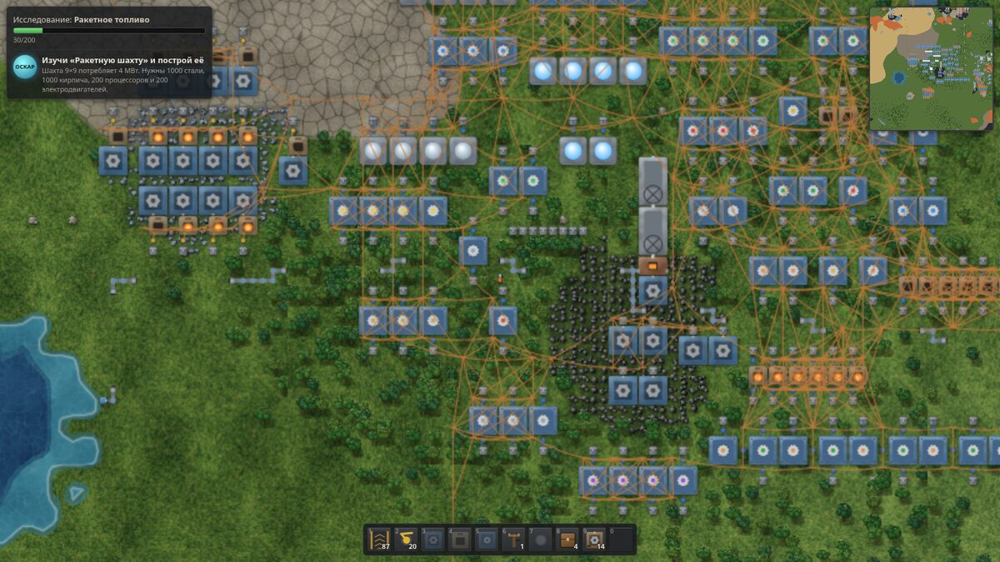

# ЗАВОД-7 1.0 — проверка по разделу 19

Все цифры сняты в песочнице разработки (Amazon Linux 2023, Node 24, headless-браузеры без видеокарты).
Повторить: `npm test && npm run chaos && npm run bench -- --check && npx tsx tools/balance.ts --check && npm run build && npm run e2e`.

## Критерии готовности

| Критерий раздела 19 | Статус | Чем подтверждено |
|---|---|---|
| Юнит-тесты: конвейеры (скорость, боковая подача, повороты, разделители) | ✔ | `core19`: 1,875 / 3,75 / 5,625 клетки/с; **15 / 30 / 45 предм./с**; линия против течения — 30; два поворота — 15; разделитель — 7,5 + 7,5. Боковая подача, повороты, подземные — `sim.test` |
| Юнит-тесты: манипуляторы (что берут и куда кладут) | ✔ | `core19`: топливо → в топливо печи, руда → во вход; из печи — только пластины; на дальнюю дорожку; длинный — через клетку; в сборщик — только нужное рецепту; твердотопливный сам заправляется |
| Юнит-тесты: сети (слияние/разделение), жидкости | ✔ | `core19`: столбы 2 → 1 → 2 сети; трубы 2 → 1 → 2 сети, вода делится 400 + 400 |
| Юнит-тесты: рецепты, исследования | ✔ | `core19`: сборщики 1/2/3 — 20/30/50 шестерён за 20 с, печь — 10 пластин за 32 с; «Автоматизация» — 100 с и 10 пакетов |
| Тест детерминизма в CI на каждый коммит | ✔ | `sim.test` + хаос-тест (тот же сценарий дважды, сохранение посреди), бот — 16 сохранений/загрузок в lockstep; `.github/workflows/ci.yml` на каждый push |
| Бенчмарки 1 000 печей / 10 000 конвейеров / 200 сборщиков с маяками, хранение в CI, предупреждение > 10% | ✔ | ≈ 0,1 / 2,4 / ≈ 0,1 мс на тик (бюджет 16,7); `tests/bench-baseline.json`, кэш Actions, `::warning::` |
| E2E: старт, новая игра, стройка, сохранение и загрузка | ✔ | `e2e5`–`e2e14`; `e2e12`, `e2e13` — в Chromium 153, Firefox 155, WebKit 18.2 |
| Плейтесты | ✘ не проводились | готовы статистика партии, файл, чек-лист 20.5 (rc3); нижняя граница — бот |
| Ракета за 15–25 ч | ✔ оценка | бот: **8 ч 14 мин** (seed 1, без врагов), до синей науки быстрее плана 9.3 в 2,9 раза → **≈ 24 ч** для игрока |
| Нет критических ошибок | ✔ | хаос-тест: 10 мин игры, ~5 700 случайных действий на поздней партии с Роем — без исключений и нарушений инвариантов; бот до ракеты без ошибок; 3 ошибки найдены и исправлены (ниже) |
| 60 FPS на средней базе | ✔ по CPU | `e2e14`, партия 1 788 построек: WebGL2 — кадр в главном потоке 3–5 мс (p95 7–9), **60 UPS**; Canvas2D без GPU — 13 мс на масштабе 1. Кадры/с в headless (32–53) упираются в программную растеризацию |
| Сохранения между версиями | ✔ | архив v0.1 – rc1 без потерь (`compat.test`), формат с версией игры с rc5 |
| RU + EN | ✔ | `e2e8`, `e2e13`: ни одной кириллической строки в английском интерфейсе |

## Найдено и исправлено при проверке
1. **Конвейеры теряли 11–27% пропускной способности** при постройке «по течению»: обновление в порядке постройки давало лишний тик зазора на каждом стыке (13,3 / 24 / 32,8 предм./с вместо 15 / 30 / 45). Теперь цепочка обновляется от дальнего конца, цели кэшируются до изменения раскладки. Цена — 10 000 конвейеров: 1,8 → 2,4 мс на тик.
2. **Сборщик 3 терял тик на цикл** (48 шестерён вместо 50 за 20 с) из-за накопления ошибки плавающей точки.
3. **После загрузки снос и улучшение шли в другом порядке**, чем в исходной партии, — продолжение расходилось. Теперь порядок по номеру постройки.

Баланс после исправления 1: оценка выросла до 26 ч из-за этапа «шахта и ракета» (×1,44 к плану 9.3) — исследование шахты удешевлено с 500 до 400 пакетов. Итог: 24 ч, худший этап ×1,28.

## Замеры
- `npm test`: 225 проверок; `e2e12` — 120, `e2e13` — 99 в трёх браузерах.
- Средняя база (`e2e14`, 1600×900, без GPU):

| Рендер | Масштаб | Кадр/с (headless) | Кадр в главном потоке, медиана / p95 | UPS |
|---|---|---|---|---|
| Canvas2D (авто без GPU) | 1 | 52 | 13,4 / 18,3 мс | 60 |
| Canvas2D | 0,5 | 46 | 17,3 / 27,8 мс | 60 |
| WebGL2 | 1 | 39 | 3,4 / 7,7 мс | 60 |
| WebGL2 | 0,5 | 32 | 5,0 / 9,1 мс | 60 |

  В Canvas2D без GPU ~85% кадра — программная растеризация `drawImage` в Skia; собственный JS отрисовки — 1–2 мс.

## Известные ограничения
См. README → «Известные ограничения 1.0»: оценка времени — по боту, а не людям; Safari — WebKit под Linux; озвучка — через подмену; FPS — без GPU; бот играет без Роя.
