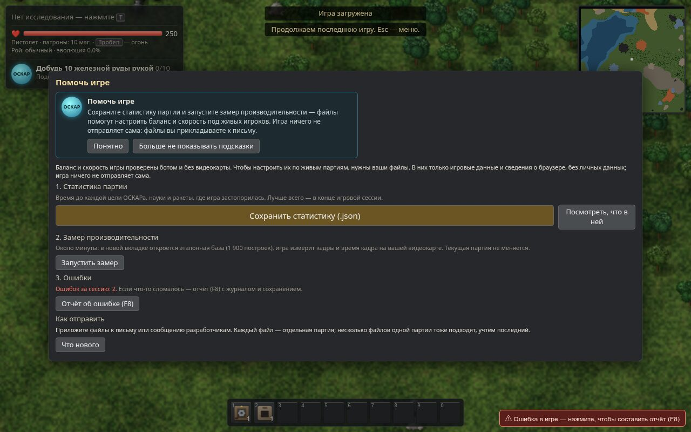
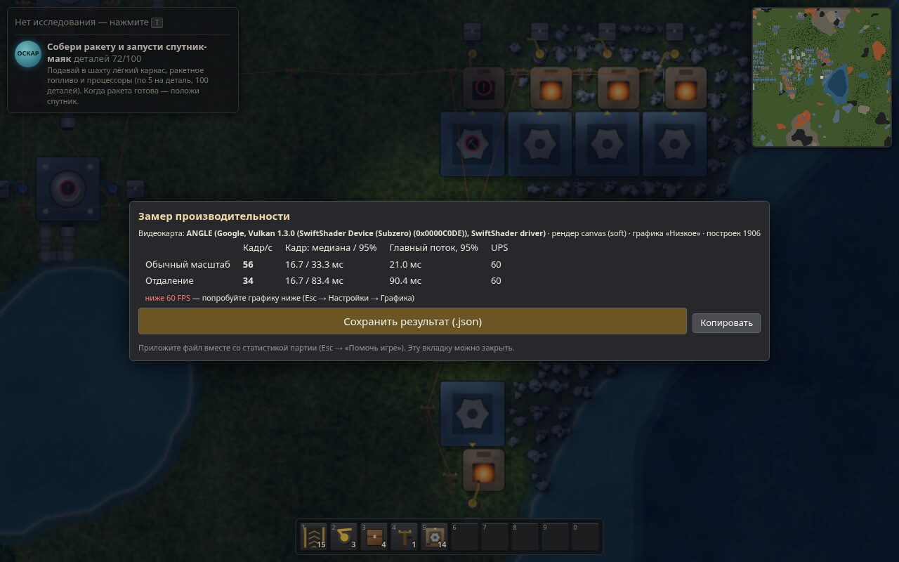

# v1.1 «Стабилизация» — как собрать данные и закрыть критерии

Версия **1.1.0-rc.1** — «готово к сбору данных». Всё, что можно сделать без живых игроков и настоящих видеокарт,
сделано и проверено; критерии «Готово, когда» закрываются только по файлам игроков и замерам на железе.
Порядок ниже — по плану v1.1 (неделя 1 — сбор, неделя 2 — правки).

## 1. Что получает игрок

- **Esc → «Помочь игре»** — одно окно на всё: сохранить статистику партии (.json), замер производительности,
  отчёт об ошибке (F8), «Что нового». Если сборка сделана с `ZAVOD_FEEDBACK=<ссылка на форму/почту>` — кнопка «Отправить».
  Игра ничего не отправляет сама: игрок прикладывает файл к письму или форме.
- **«Что нового»** открывается само один раз после обновления (не при первом запуске — там обучение),
  повторно — Esc → Бета-тест → «Что нового». Там же просьба прислать файл (риск «мало файлов» из плана).
- **Замер производительности** — отдельная вкладка `index.html?bench=1`: загружает встроенную эталонную базу
  (v1.0-late, 1 906 построек), 3 с прогрева + 2 фазы по 10 с (масштаб 1 и 0,5), без ограничения FPS и без
  автосохранения; партия игрока не трогается. Результат — `zavod7-gpubench-*.json`.
- Статистика партии теперь **v2**: сессии (когда играли) и ошибки клиента (подпись без адресов/чисел, не чаще
  раза в 2 с и не больше 50 за сессию) — для «падений на 100 ч». В отчёте F8 — строка `install:`, чтобы
  склеить отчёт с файлом статистики того же игрока.




## 2. Сбор файлов (неделя 1)

1. Раздать сборку (`dist/` или `zavod7-v1.1-game.zip`) 20+ бета-игрокам. Попросить в конце каждого сеанса:
   Esc → «Помочь игре» → «Сохранить статистику». Повторные файлы одного игрока не мешают — берётся последний.
2. Сложить все файлы (`zavod7-playtest-*.json`, `zavod7-gpubench-*.json`, отчёты F8 `*.txt`) в одну папку, например `playtests/`.
3. Сводка:
   ```
   npx tsx tools/stats-report.ts playtests/ --out report.md --json report.json
   npx tsx tools/stats-report.ts playtests/ --check      # код возврата 1, пока не все критерии выполнены
   ```
   Что в сводке: таблица критериев «Готово, когда»; медиана и разброс до каждой цели ОСКАРа, каждой науки и
   ракеты; медиана до ракеты среди дошедших и **с учётом не дошедших (Каплан — Мейер)** — вторая честнее, первая
   занижена; этапы против плана 9.3; чек-лист «первого часа»; бросившие до электричества; где застревают
   (цель → что не работало) и где инженер упирается; ошибки по числу игроков (⚠ — у > 5%); замеры по видеокартам.
4. Пример на синтетике — [`docs/stats-report-SYNTHETIC.md`](stats-report-SYNTHETIC.md) (24 файла из
   `tools/fake-players.ts` + 3 замера из headless-браузеров). **Это не данные игроков**: файлы помечены
   `"synthetic": true`, сводка пишет предупреждение.

## 3. Баланс (неделя 2)

Сводка сама предлагает правку по правилу плана: если прошли до ракеты ≥ 10 игроков и медиана > 25 ч или < 15 ч —
этапы, отстающие от плана 9.3 (обгоняющие) больше чем на 30%, получают множитель стоимости исследований
(до плана, но не больше ×2 и не меньше ×0,5 за раз; новые стоимости — кратные 10). При медиане > 30 ч — только
поздние этапы (синяя наука и дальше), ранние — в v1.2. После правки `src/data/techs.ts`:
```
npx tsx tools/bot/run.ts              # повторный прогон бота (~15 мин), shots/bot-report.json
npx tsx tools/balance.ts --check      # сверка с целями 13.3 / 9.3
npm test && npm run chaos
```
и запись в `src/data/news.ts` (раздел «Баланс» окна «Что нового»).

## 4. Замеры на 6 конфигурациях

Intel UHD, AMD Vega, GeForce GTX 1650, Apple M1, Chromebook, ноутбук 2016 г. На каждой: открыть игру →
Esc → «Помочь игре» → «Замер производительности» (или сразу `index.html?bench=1`), не трогать мышь ~25 с,
«Сохранить результат». Для сравнения рендеров — `?bench=1&render=canvas`. Критерий: **кадр (медиана) ≤ 16,9 мс и
≥ 57 кадр/с** (`ok60`) с WebGL2 на встроенной графике. Если `gpu` в файле пустой или «Apple GPU» — браузер скрывает
модель (Safari, Firefox с защитой от отпечатков): впишите модель в имя файла. В headless-браузерах
(SwiftShader) замер идёт, но это не GPU — сводка относит его к классу `software`.

Игра запрашивает у браузера высокопроизводительный графический адаптер, но браузер и система решают, какой адаптер использовать; это не гарантирует выбор дискретной видеокарты. В Windows можно открыть **Параметры → Система → Дисплей → Графика**, выбрать браузер, задать **Высокая производительность** и сохранить настройку. Для применения может потребоваться перезапустить браузер. Фактически используемый WebGL-адаптер показан в F3 и в отчёте замера; режим Canvas честно отмечается как Canvas2D без активного WebGL-контекста. [Инструкция Microsoft по настройке графики](https://support.microsoft.com/en-us/windows/hardware/display-graphics/optimizations-for-windowed-games-in-windows-11).

## 5. Ручные проверки (живьём)

| Что | Как | Итог |
|---|---|---|
| Голоса Windows / macOS / Android | Настройки → Голос ОСКАРа: вступление, «цель выполнена», озвучка интерфейса «всё»; RU и EN | ждёт проверки |
| Safari на настоящем Mac | `e2e13`/`e2e12` прошли в WebKit 18.2 под Linux; на Mac — сохранение, загрузка, жесты тачпада (щипок — масштаб, два пальца — сдвиг) | ждёт проверки |
| Тачпад Windows/Linux | прокрутка двумя пальцами, щипок, ПКМ двумя пальцами | ждёт проверки |
| Ошибки F8 | исправлять по таблице «Ошибки» сводки сверху вниз (по числу игроков) | ждёт отчётов |

## 6. Критерии «Готово, когда»

| Критерий | Чем проверяется | Статус rc.1 |
|---|---|---|
| Медиана до ракеты 15–25 ч, ≥ 10 прошедших | `stats-report` → `rocket` | ждёт данных (оценка по боту ≈ 24 ч) |
| Чек-лист «первого часа» ≥ 70% | `stats-report` → `firstHour` | ждёт данных |
| Бросили до электричества ≤ 20% | `stats-report` → `quit` | ждёт данных |
| 60 FPS на эталонной базе, встроенная графика | `gpubench` → `ok60` | ждёт замеров на железе |
| Падений на 100 ч ≤ 1 | статистика v2 + F8 (вердикт с 100 ч игры) | ждёт данных |
| 0 ошибок у > 5% игроков, 0 критических | `stats-report` → «Ошибки» | ждёт данных; известных открытых ошибок нет |

Вердикт «мало данных» ставится, пока данных недостаточно: < 10 дошедших до ракеты, < 5 игроков для чек-листа и
доли бросивших, < 100 ч игры для падений, нет замера со встроенной графикой.
