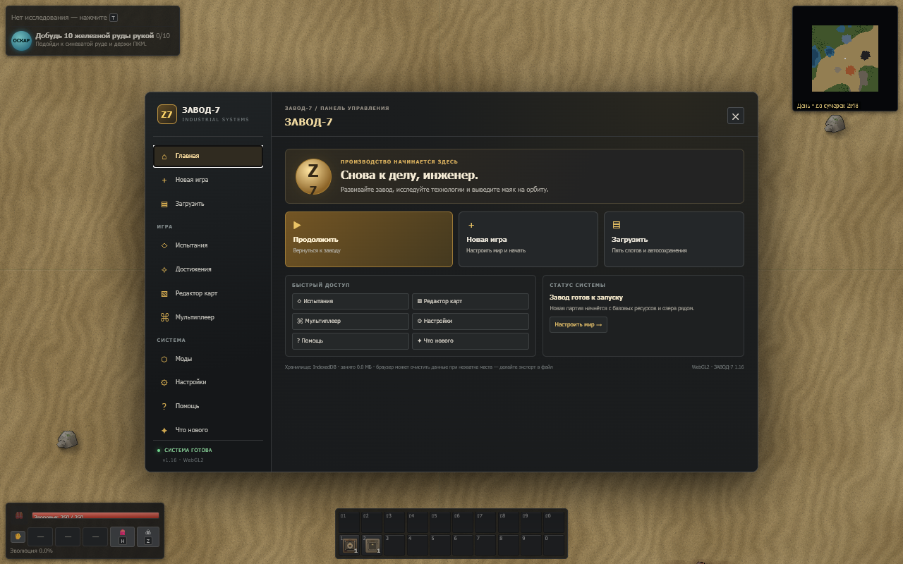
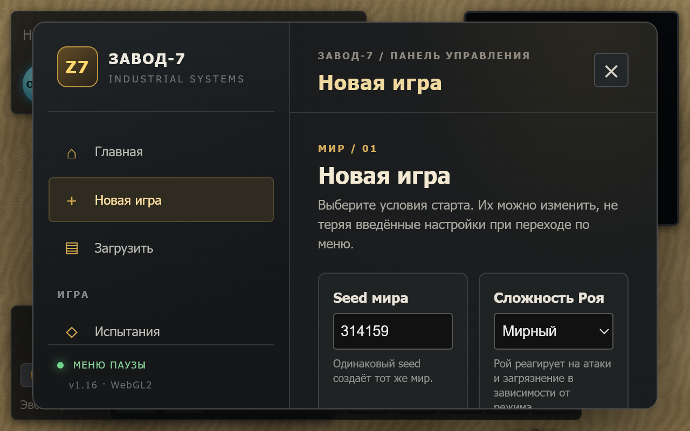
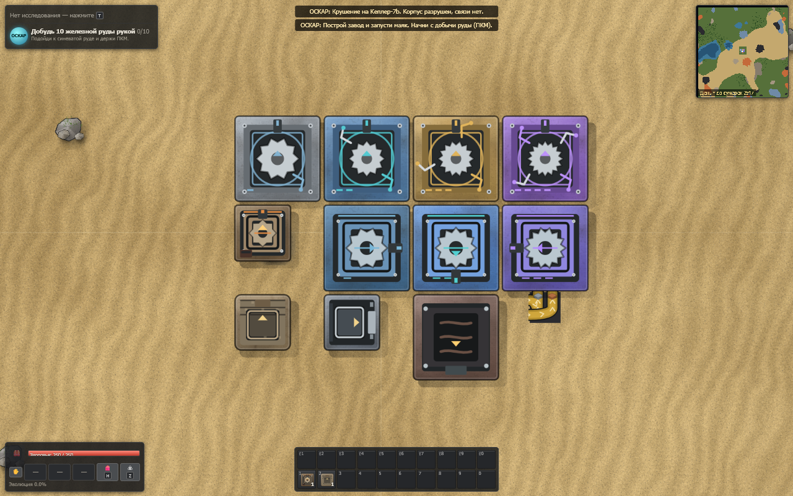
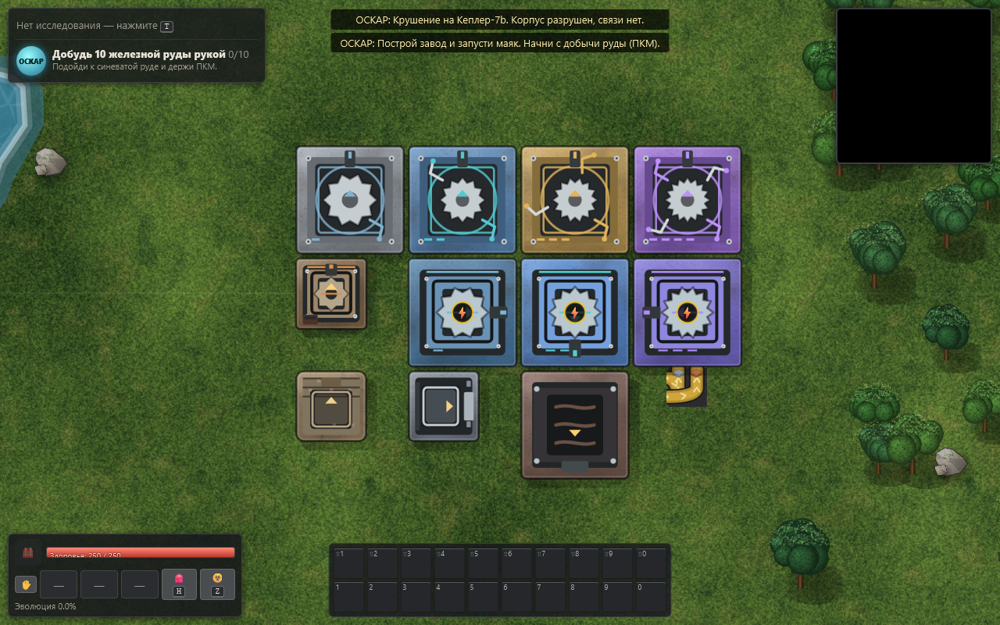

# ЗАВОД-7 v1.16 — UI и графика

## Изменения

- Главное меню и меню паузы используют одну оболочку с переходами между главной страницей, настройкой новой игры и загрузкой. Испытания, достижения, редактор карт, мультиплеер, моды, настройки, помощь и «Что нового» открываются как дочерние экраны; возврат сохраняет текущую страницу, язык и черновик настроек мира.
- Страница загрузки показывает пять ручных слотов отдельно от автосохранений. Устаревшая подсказка про три слота заменена на «Пять слотов и автосохранения» / “Five slots and autosaves”. Название мира в карточках формируется из seed: в модели сохранения нет отдельного редактируемого имени.
- Окно редактора накладывается на оболочку меню и возвращает в неё по Esc. Открытие меню приостанавливает игру, ввод движения в меню перехватывается; продолжение и закрытие паузы восстанавливают предыдущее состояние симуляции.
- Масштаб 75–200% применяется к оболочке и её содержимому. При 200% контент прокручивается по вертикали, переходы и кнопка старта остаются достижимы; в проверенных размерах нет горизонтального переполнения.
- Обновлены варианты сборщиков, буров и печей: уровни различаются материалом и деталями, стороны вывода ориентируются по направлению машины, рабочие состояния используют анимацию ротора/манипуляторов и тепловых эффектов.
- Геометрия кривой ленты теперь общая для симуляции и sprite renderer. Обе дорожки проходят настоящий плавный поворот; правила шага, пропускная способность и порядок предметов в `updateBelt` не менялись.

## Проверки

- `npm.cmd run typecheck` — успешно.
- `npm.cmd run build` — успешно; итоговый `dist/index.html` — 2475 KB.
- `npm.cmd exec tsx -- tests/v116-ui-geometry.test.ts` — успешно: все направления поворотов, обе дорожки, непрерывность входа/выхода, отсутствие разворота и сохранение раздельности полос.
- `npm.cmd exec tsx -- tools/i18n-check.ts src/ui/ui.ts` — успешно, 2205 строк.
- `tests/e2e-ui-v116.mjs` на Playwright 1.62.0 прошёл в Chromium и WebKit. Сценарий проверяет маршруты меню и Back, редактор и Esc, пять слотов, сохранение seed/режима/параметров генерации, переключение RU/EN, границы и переполнение на 75%/200%, прокрутку страницы новой игры, паузу/возобновление и захват клавиш, а также WebGL2 и Canvas2D с четырьмя сборщиками, четырьмя бурами, тремя печами и двухполосным поворотом. В обоих renderer-сессиях нет uncaught page errors.
- Полный `npm.cmd test` не запускался в этом UI-срезе; перечисленные проверки целевые для изменённой графики, геометрии и меню.
- Firefox E2E не удалось запустить в этой Windows-среде: Playwright 1.62.0 с управляемым Firefox 153 падает на `firefox.exe` с `spawn UNKNOWN` ещё до загрузки приложения. Проверка Firefox остаётся незавершённой.
- После интеграции обновлён полный запуск `node --import tsx tools/i18n-check.ts --full`: exit 0, проверено 4691 строка, отсутствующих переводов нет.

## Дополнение после интеграции GPU и меню

- `npm.cmd exec -- tsx tests/gpu-v116.test.ts` — exit 0. Проверяются запрос `powerPreference: high-performance`, передача действующего игрового WebGL-контекста в отчёт, честные Canvas/unknown состояния и отсутствие потери контекста ради диагностики.
- После изменений `npm.cmd run typecheck` и `npm.cmd run build` завершились с exit 0; собранный на тот момент `dist/index.html` — 2625 KB.
- Актуальный `npm.cmd run e2e -- e2e15` с `PW_BROWSER=chromium` завершился с exit 0; лог: `integration-logs/ui-v116-e2e15-chromium-final3.log`. Проверены автоматическое открытие новостей после известной старой версии и отсутствие повторного показа после перезагрузки, передача ошибки телеметрии после шага Worker, F8-отчёт, английские экраны и F3.
- В этом браузерном запуске игра действительно использовала `ANGLE (Intel, Intel(R) UHD Graphics (0x000046A3) Direct3D11 vs_5_0 ps_5_0, D3D11)`; клиентский отчёт и bench совпали с действующим игровым контекстом. `powerPreference` — только подсказка браузеру, а не гарантия выбора дискретного адаптера. Значение FPS в E2E15 не является изолированным hardware-performance gate.
- Первый запуск Firefox в первоначальном UI-срезе завершился до старта приложения с Windows `spawn UNKNOWN`; это историческое ограничение того запуска. Полная интеграционная браузерная матрица Chromium/Firefox/WebKit в настоящий отчёт не входит и требует отдельного подтверждения на итоговой сборке.

Фактические снимки из успешных browser E2E:

## Границы аудита по контракту

Этот отчёт подтверждает только меню, машинную графику и геометрию лент. Смежные положения §12, §15.1–15.3 не заявляются завершёнными по этим проверкам: сюда относятся панели и диагностика ядерной цепочки, прогресс/очередь исследований и резервы ручного крафта, радары и их радиусы, инвентарь и длинные названия предметов вне меню, графики энергии и цикла дня, а также инструменты управления фабрикой. Их реализацию или состояние нужно отдельно свести с остальными v1.16 работами и проверить интеграционно.
